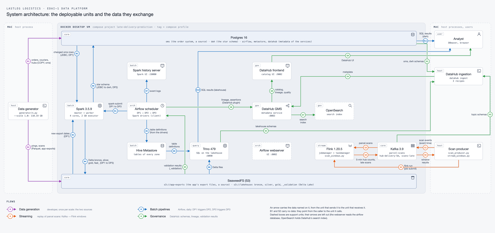

# Late-delivery prediction: the LastLeg Logistics data platform

The EDAI-1 coursework data platform for **LastLeg Logistics**, a fictional last-mile parcel carrier
in the Los Angeles area. The platform generates the company's source data, moves it through
bronze, silver and gold lakehouse zones, and builds the feature tables that a model will use to
predict late deliveries. The model itself is trained in EDAI-2.

All data in this repository is synthetic, and the company is fictional.

## Table of contents

1. [Business domain](#business-domain)
2. [Architecture](#architecture)
3. [Repo structure](#repo-structure)
4. [Requirements](#requirements)
5. [Documentation](#documentation)

## Business domain

LastLeg Logistics delivers parcels from about 40 hubs across Los Angeles.

- **Prediction moment:** the `picked_up` scan, when a courier leaves the hub with the parcel. At
  that moment the courier, vehicle, traffic, weather and hub load are known, and the dispatcher can
  still act.
- **Label:** a delivery is late when `delivered_ts > promised_ts`.
- **Promised time:** `promised_ts = order_ts + SLA`. The SLA is set when the customer orders, from
  the area type plus 3 minutes per km of distance from the hub to the drop point.
- **Seed data:** the [Amazon Delivery Dataset](https://www.kaggle.com/datasets/sujalsuthar/amazon-delivery-dataset)
  on Kaggle (MIT license, 43,739 rows). It only sets the shapes of the generated data, such as how
  traffic and weather change delivery time. Every row in the platform is generated.

EDAI-1 builds the data platform and the feature tables. It does not train a model.

## Architecture

### Overview


Each batch step writes one zone of the lakehouse, and the next step reads it from there. DP1
copies the sources into bronze, DP2 builds silver, gold and the `dwh` warehouse, and DP3 builds
the `feat_` tables. The stream counts the deliveries per hub in 5-minute windows. The two novel
ideas are in red: the H3 delivery zones from Apache Sedona, and the incremental DP3 from Delta's
Change Data Feed.

### System diagram



Every box is a deployable unit: a container of one Compose profile (its tag) or a process on the
Mac. Each arrow carries the data named on it, from the unit that sends the data to the unit that
receives it. B1 and S2 carry no data: they point from the caller to the unit it calls. Each flow
has its own colour and its own numbers, and two arrows cross only where the line shows a gap.
The dashed boxes are support units whose arrows are left out: the Airflow webserver (it reads the
`airflow` database) and OpenSearch (DataHub's search index).

Both pictures are drawn by [`docs/diagrams/draw.py`](docs/diagrams/draw.py) (stdlib Python; PNG
through headless Chrome) from two sources each: the topology in [`system.json`](docs/diagrams/system.json)
and [`overview.json`](docs/diagrams/overview.json), in the typed architecture IR of the ak-diagram
tool, and the coordinates in [`system_layout.py`](docs/diagrams/system_layout.py) and
[`overview_layout.py`](docs/diagrams/overview_layout.py). The script refuses a layout in which an
arrow crosses a box or a label overlaps a box, a line or another label.

| Flow | Colour | What moves |
|---|---|---|
| Data generation, D1 and D2 | purple | The generator fills the two sources once per scale: the order system in Postgres `oms` (D1, `COPY`) and the app's export files in `s3://app-exports` (D2, Parquet). |
| Batch pipelines, B1 to B11 | blue | DP1 runs daily and triggers DP2, which triggers DP3. The Airflow scheduler submits each job to Spark and runs its driver (B1). The executors read the changed `oms` rows (B2) and the new export dates (B3) and write the Delta tables of bronze, silver, gold and the features (B4). The drivers register the tables in the Hive Metastore (B5) and write the Spark event logs (B7). DP2 loads the `dwh` star schema (B6). Trino reads the Delta files (B8) with the table definitions (B9) and answers SQL on the lakehouse (B10); Postgres answers SQL on `dwh` (B11). |
| Streaming, S1 to S5 | orange | The scan producer replays a week of parcel scans into Kafka, with each scan's event time as the record time (S1), and submits the Flink job (S2). Flink reads the scans (S3) and writes the 5-minute hub counts and the late scans back (S4). `stream_windows.py` reads the results to check them against the truth (S5). |
| Governance, G1 to G9 | green | DataHub's ingestion reads the schemas of `oms` and `dwh` (G1), of the lakehouse through Trino (G2) and of the Kafka topics (G3), and sends them to GMS (G4). `publish_assertions` reads the validation results from `s3://lakehouse/_validation` (G5), and Airflow sends each task's lineage and those results as assertions (G6). GMS indexes the metadata in OpenSearch (G7) and serves the catalog, lineage and quality to the frontend (G8), which the analyst opens in a browser (G9). |

| Profile | Deployable units | Details |
|---|---|---|
| `core` | Postgres 16 (`oms`, `dwh`, `airflow`, `metastore`, `datahub`), SeaweedFS (buckets `app-exports`, `lakehouse`), Kafka 3.9 | [core_services.md](docs/core_services.md) |
| `batch` | Hive Metastore, Spark 3.5.9 master, worker and history server, with Delta Lake 3.3.3 | [lakehouse.md](docs/lakehouse.md) |
| `query` | Trino 479 | [lakehouse.md](docs/lakehouse.md) |
| `orch` | Airflow 2.10.5 webserver and scheduler | [airflow.md](docs/airflow.md) |
| `gov` | DataHub v1.5.0.6 GMS and frontend, OpenSearch | [datahub.md](docs/datahub.md) |
| `stream` | Flink 1.20.5 jobmanager and taskmanager (PyFlink) | [streaming.md](docs/streaming.md) |
| on the Mac | the data generator, the scan producer, the DataHub ingestion | [data_generator.md](docs/data_generator.md) |

Start the platform with `cp .env.example .env` (then change the passwords) and
`docker compose --profile core --profile batch --profile query --profile orch --profile gov --profile stream up -d --wait`.
Each profile can also start on its own, on top of `core`.

## Repo structure

```text
.
├── README.md            this file: domain, architecture, structure, links to docs
├── docker-compose.yaml  every service, grouped by Compose profile
├── generator/           host-Python data generator (seed model, LA config, oms tables, app exports),
│   │                    the scan producer, and the checks of the generated data and the stream
│   └── sql/             DDL of the oms tables, applied by the generator
├── jobs/                Spark jobs: DP1 ingest, DP2 silver, gold and warehouse, DP3 features,
│   │                    the validation suites, the checks, and the benchmarks
│   └── sql/             DDL of the dwh star schema and its indexes
├── airflow/             the DP1 to DP3 DAGs (dags/) and the init script for connections, variables and pool
├── flink/jobs/          the PyFlink window job (scan_windows.py)
├── datahub/recipes/     DataHub ingestion recipes (Trino lakehouse, Postgres oms and dwh, Kafka)
├── infra/
│   ├── postgres/init/   SQL run on the first start of Postgres (creates the databases)
│   ├── spark/           the Spark image (Dockerfile, Dockerfile.naive) and conf/spark-defaults.conf
│   ├── airflow/         the Airflow image (Dockerfile, Dockerfile.naive)
│   ├── flink/           the Flink image (Dockerfile, Dockerfile.naive)
│   └── trino/catalog/   Trino catalog delta (Delta tables through the Hive Metastore)
├── scripts/             safe-shutdown.sh (stop and eject the SSD), disk-watch.sh (stop jobs at low disk),
│                        schema_catalog.py (naming check, diagrams), dwh_indexes.py (index measurements)
├── tests/               pytest checks, run with: uv run pytest
├── seed/                the Kaggle seed file (gzipped) and its MIT license
├── docs/                one document per major part, with its screenshots in docs/images/
│   └── diagrams/        the README diagrams: their IR (*.json), layouts and the drawing script
├── pyproject.toml       Python project settings, dependencies and the ruff lint rules
├── uv.lock              exact versions of every Python dependency
├── .env.example         template for the local .env file (the real .env is never committed)
└── .gitignore           files and folders that git must never track
```

## Requirements

- An Apple Silicon Mac. Every image runs as linux/arm64 ([image inventory](docs/environment.md#image-inventory)).
- Docker Desktop with 16 GB memory, 8 CPUs, 2 GB swap and an 800 GB disk limit. Its disk image is
  on an external SSD; run `scripts/safe-shutdown.sh` before unplugging it
  ([procedure](docs/environment.md#start-stop-and-unplug-safely)).
- [uv](https://docs.astral.sh/uv/) for Python. `uv sync` installs Python 3.10 and the
  dependencies, `uv run pytest` runs the tests, and `uvx ruff check .` runs the linter.

## Documentation

All detailed documents live in [`docs/`](docs/README.md). This README only summarizes them.

| Document | What it shows |
|---|---|
| [environment.md](docs/environment.md) | The machine, every image and its size (naive against multi-stage), memory, PyFlink on arm64, disk safety, the safe stop |
| [core_services.md](docs/core_services.md) | Postgres, SeaweedFS and Kafka |
| [data_generator.md](docs/data_generator.md) | How the source data is generated, with its dirty values, schema change and duplicates |
| [data_characteristics.md](docs/data_characteristics.md) | The generated data: volume, skew, cardinality, schemas, duplicate rates |
| [lakehouse.md](docs/lakehouse.md) | Hive Metastore, Spark, Delta Lake and Trino |
| [pipelines.md](docs/pipelines.md) | The DP1 to DP3 Spark jobs and their validation suites |
| [schema_design.md](docs/schema_design.md) | The tables of every zone, their relationships and the naming check |
| [airflow.md](docs/airflow.md) | The three DAGs, connections, variables and pool, and the failure drill |
| [datahub.md](docs/datahub.md) | Schemas, lineage and data quality in DataHub |
| [streaming.md](docs/streaming.md) | The scan stream and the Flink window job: baseline, allowed lateness, dedup |
| [spark_optimization.md](docs/spark_optimization.md) | Spark at 100 GB: the skew join, schema evolution and duplicates, with Spark UI screenshots |
| [storage_optimization.md](docs/storage_optimization.md) | Warehouse indexes and the lakehouse file layout |
| [novel_h3_sedona.md](docs/novel_h3_sedona.md) | Novel idea 1: H3 delivery zones with Apache Sedona |
| [novel_cdf_incremental.md](docs/novel_cdf_incremental.md) | Novel idea 2: incremental DP3 from Delta's Change Data Feed |
