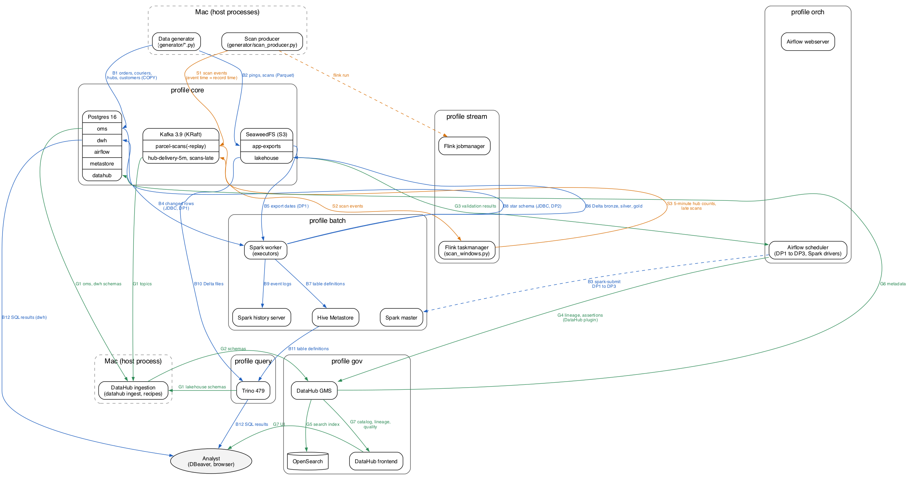

# Late-delivery prediction: the LastLeg Logistics data platform

The EDAI-1 coursework data platform for **LastLeg Logistics**, a fictional last-mile parcel carrier
in the Los Angeles area. The platform generates the company's source data, moves it through
bronze, silver and gold lakehouse zones, and builds the feature tables that a model will use to
predict late deliveries. The model itself is trained in EDAI-2.

All data in this repository is synthetic, and the company is fictional.

## Table of contents

1. [Business domain](#business-domain)
2. [Architecture](#architecture)
3. [Repo structure](#repo-structure)
4. [Requirements](#requirements)
5. [Documentation](#documentation)

## Business domain

LastLeg Logistics delivers parcels from about 40 hubs across Los Angeles.

- **Prediction moment:** the `picked_up` scan, when a courier leaves the hub with the parcel. At
  that moment the courier, vehicle, traffic, weather and hub load are known, and the dispatcher can
  still act.
- **Label:** a delivery is late when `delivered_ts > promised_ts`.
- **Promised time:** `promised_ts = order_ts + SLA`. The SLA is set when the customer orders, from
  the area type plus 3 minutes per km of distance from the hub to the drop point.
- **Seed data:** the [Amazon Delivery Dataset](https://www.kaggle.com/datasets/sujalsuthar/amazon-delivery-dataset)
  on Kaggle (MIT license, 43,739 rows). It only sets the shapes of the generated data, such as how
  traffic and weather change delivery time. Every row in the platform is generated.

EDAI-1 builds the data platform and the feature tables. It does not train a model.

## Architecture



Every box is a deployable unit: a container of one Compose profile, or a process run on the Mac.
Arrows follow the data and carry it as their label. Each flow has its own colour and numbering,
and the two dashed arrows are calls that carry no data. The source is
[`docs/images/architecture/deployment.dot`](docs/images/architecture/deployment.dot) (Graphviz).

| Flow | Colour | What moves |
|---|---|---|
| Batch, B1 to B12 | blue | The generator fills the sources, `oms` and `app-exports` (B1, B2). Airflow submits DP1 to DP3 to Spark (B3). DP1 copies changed rows and new export dates into bronze (B4, B5). DP2 and DP3 build silver, gold and the features (B6), register the tables in the Hive Metastore (B7) and load the `dwh` star schema (B8). Trino serves the lakehouse and Postgres serves `dwh` to analysts (B10 to B12). |
| Stream, S1 to S3 | orange | The scan producer replays parcel scans into Kafka, with event time as the record time (S1). Flink reads them (S2) and writes 5-minute hub counts and late scans back (S3). |
| Governance, G1 to G7 | green | The DataHub recipes read the schemas of every zone (G1, G2). Airflow's DataHub plugin sends each task's lineage, and the Great Expectations results as assertions (G3, G4). The frontend shows the catalog, lineage and quality (G7). |

| Profile | Deployable units | Details |
|---|---|---|
| `core` | Postgres 16 (`oms`, `dwh`, `airflow`, `metastore`, `datahub`), SeaweedFS (buckets `app-exports`, `lakehouse`), Kafka 3.9 | [core_services.md](docs/core_services.md) |
| `batch` | Hive Metastore, Spark 3.5.9 master, worker and history server, with Delta Lake 3.3.3 | [lakehouse.md](docs/lakehouse.md) |
| `query` | Trino 479 | [lakehouse.md](docs/lakehouse.md) |
| `orch` | Airflow 2.10.5 webserver and scheduler | [airflow.md](docs/airflow.md) |
| `gov` | DataHub v1.5.0.6 GMS and frontend, OpenSearch | [datahub.md](docs/datahub.md) |
| `stream` | Flink 1.20.5 jobmanager and taskmanager (PyFlink) | [streaming.md](docs/streaming.md) |
| on the Mac | the data generator, the scan producer, the DataHub ingestion | [data_generator.md](docs/data_generator.md) |

Start the platform with `cp .env.example .env` (then change the passwords) and
`docker compose --profile core --profile batch --profile query --profile orch --profile gov --profile stream up -d --wait`.
Each profile can also start on its own, on top of `core`.

## Repo structure

```text
.
├── README.md            this file: domain, architecture, structure, links to docs
├── docker-compose.yaml  every service, grouped by Compose profile
├── generator/           host-Python data generator (seed model, LA config, oms tables, app exports),
│   │                    the scan producer, and the checks of the generated data and the stream
│   └── sql/             DDL of the oms tables, applied by the generator
├── jobs/                Spark jobs: DP1 ingest, DP2 silver, gold and warehouse, DP3 features,
│   │                    the validation suites, the checks, and the benchmarks
│   └── sql/             DDL of the dwh star schema and its indexes
├── airflow/             the DP1 to DP3 DAGs (dags/) and the init script for connections, variables and pool
├── flink/jobs/          the PyFlink window job (scan_windows.py)
├── datahub/recipes/     DataHub ingestion recipes (Trino lakehouse, Postgres oms and dwh, Kafka)
├── infra/
│   ├── postgres/init/   SQL run on the first start of Postgres (creates the databases)
│   ├── spark/           the Spark image (Dockerfile, Dockerfile.naive) and conf/spark-defaults.conf
│   ├── airflow/         the Airflow image (Dockerfile, Dockerfile.naive)
│   ├── flink/           the Flink image (Dockerfile, Dockerfile.naive)
│   └── trino/catalog/   Trino catalog delta (Delta tables through the Hive Metastore)
├── scripts/             safe-shutdown.sh (stop and eject the SSD), disk-watch.sh (stop jobs at low disk),
│                        schema_catalog.py (naming check, diagrams), dwh_indexes.py (index measurements)
├── tests/               pytest checks, run with: uv run pytest
├── seed/                the Kaggle seed file (gzipped) and its MIT license
├── docs/                one document per major part, with its screenshots in docs/images/
├── pyproject.toml       Python project settings, dependencies and the ruff lint rules
├── uv.lock              exact versions of every Python dependency
├── .env.example         template for the local .env file (the real .env is never committed)
└── .gitignore           files and folders that git must never track
```

## Requirements

- An Apple Silicon Mac. Every image runs as linux/arm64 ([image inventory](docs/environment.md#image-inventory)).
- Docker Desktop with 16 GB memory, 8 CPUs, 2 GB swap and an 800 GB disk limit. Its disk image is
  on an external SSD; run `scripts/safe-shutdown.sh` before unplugging it
  ([procedure](docs/environment.md#start-stop-and-unplug-safely)).
- [uv](https://docs.astral.sh/uv/) for Python. `uv sync` installs Python 3.10 and the
  dependencies, `uv run pytest` runs the tests, and `uvx ruff check .` runs the linter.

## Documentation

All detailed documents live in [`docs/`](docs/README.md). This README only summarizes them.

| Document | What it shows |
|---|---|
| [environment.md](docs/environment.md) | The machine, every image and its size (naive against multi-stage), memory, PyFlink on arm64, disk safety, the safe stop |
| [core_services.md](docs/core_services.md) | Postgres, SeaweedFS and Kafka |
| [data_generator.md](docs/data_generator.md) | How the source data is generated, with its dirty values, schema change and duplicates |
| [data_characteristics.md](docs/data_characteristics.md) | The generated data: volume, skew, cardinality, schemas, duplicate rates |
| [lakehouse.md](docs/lakehouse.md) | Hive Metastore, Spark, Delta Lake and Trino |
| [pipelines.md](docs/pipelines.md) | The DP1 to DP3 Spark jobs and their validation suites |
| [schema_design.md](docs/schema_design.md) | The tables of every zone, their relationships and the naming check |
| [airflow.md](docs/airflow.md) | The three DAGs, connections, variables and pool, and the failure drill |
| [datahub.md](docs/datahub.md) | Schemas, lineage and data quality in DataHub |
| [streaming.md](docs/streaming.md) | The scan stream and the Flink window job: baseline, allowed lateness, dedup |
| [spark_optimization.md](docs/spark_optimization.md) | Spark at 100 GB: the skew join, schema evolution and duplicates, with Spark UI screenshots |
| [storage_optimization.md](docs/storage_optimization.md) | Warehouse indexes and the lakehouse file layout |
| [novel_h3_sedona.md](docs/novel_h3_sedona.md) | Novel idea 1: H3 delivery zones with Apache Sedona |
| [novel_cdf_incremental.md](docs/novel_cdf_incremental.md) | Novel idea 2: incremental DP3 from Delta's Change Data Feed |
