# Airflow: orchestration of DP1 to DP3

Airflow runs the three pipelines' Spark jobs (`jobs/`) in order, on a schedule, and records every
run. This page covers the image, the services, where connections and variables come from, and the
DAGs.

## Services (profile `orch`)

| Service | Role | Port on the Mac | Memory |
|---|---|---|---|
| `airflow-init` | one-shot: migrates the `airflow` database (in the shared Postgres), creates the admin user, then the connections, variables and pool | | |
| `airflow-webserver` | the UI, with 1 gunicorn worker | `127.0.0.1:8082` (user `admin`, password `AIRFLOW_ADMIN_PASSWORD` in `.env`) | 784 MiB |
| `airflow-scheduler` | runs the tasks (LocalExecutor). A Spark task's driver runs here, in client mode | | 475 MiB at idle |

`orch` runs on top of `core` and `batch`:

```bash
docker compose --profile core --profile batch --profile orch up -d --wait
```

## The image (`infra/airflow/Dockerfile.naive`, then `Dockerfile`)

The services now run `lastleg/airflow:2.10.5` from the multi-stage `infra/airflow/Dockerfile`:
2.31 GB, on the slim Airflow image with only the providers the DAGs use
([environment.md](environment.md#built-images-naive-against-multi-stage)). The rest of this section
describes the first, naive build, kept as the size baseline.

The naive image is built on `apache/airflow:2.10.5-python3.10` and is 3.23 GB. This first version is
deliberately naive: everything is copied and installed in one image and nothing is removed. The
multi-stage rewrite above replaced it.

| Part | Why |
|---|---|
| Java 17 and `/opt/spark`, copied from `lastleg/spark:3.5.9-naive` | a Spark client identical to the cluster, with every lakehouse jar, so the driver Airflow starts matches the executors |
| `/opt/driver-python`, a virtual environment with Great Expectations 0.18.19, Sedona 1.9.0, h3 4.5.0 and delta-spark 3.3.3 | the drivers' Python. GE and Sedona pin versions that clash with Airflow's. PySpark itself comes from `SPARK_HOME` at run time, so it always matches the cluster |
| `apache-airflow-providers-apache-spark` 5.0.0, without its dependencies | `SparkSubmitOperator` only calls the `spark-submit` binary, so it does not need its 340 MB PySpark dependency |
| `acryl-datahub-airflow-plugin` 1.5.0.17 | lineage and assertions to DataHub ([datahub.md](datahub.md)). It is on by default; set `DATAHUB_ENABLED=false` to run Airflow without the `gov` profile |

**Users and hosts.** The containers run as user `185:0`, the Spark user. That way the drivers can
write event logs to the `spark_events` volume, which the history server reads. The Airflow image
adds the user to `/etc/passwd` at start. The scheduler has the fixed hostname `airflow-scheduler`,
so the executors on `spark-worker` can connect back to the driver.

## Connections, variables and pool

**Who sees the credentials.** Only `airflow-init` reads `.env` (`env_file`). `airflow/setup_airflow.py`
stores the source credentials as Airflow connections, encrypted with `AIRFLOW_FERNET_KEY`, in the
`airflow` database. The webserver and the scheduler get two values from Compose instead: the
metadata database URL (`AIRFLOW__DATABASE__SQL_ALCHEMY_CONN`), which uses the same Postgres login,
and the Fernet key. The DAG code holds no password: a DAG reads one through a connection id, for
example `{{ conn.oms_postgres.password }}` in a templated field. Running the init again updates the
same entries.

| Connection | Type | Points to |
|---|---|---|
| `oms_postgres` | postgres | `postgres:5432/oms`, the order system (a source) |
| `dwh_postgres` | postgres | `postgres:5432/dwh`, the warehouse |
| `lakehouse_s3` | aws | SeaweedFS S3, `http://seaweedfs:8333` (`app-exports`, `lakehouse`) |
| `spark_lakehouse` | spark | `spark://spark-master:7077`, client mode |
| `datahub_rest_default` | datahub-rest | `http://datahub-gms:8080`, where the DataHub plugin and `publish_assertions` send metadata |

Every Spark task gets its hosts and logins from these connections, through templated `env_vars`
in `airflow/dags/lakehouse_tasks.py`: `OMS_JDBC_URL` and the login from `oms_postgres`, the S3 keys
from `lakehouse_s3`. The `warehouse` task writes to `dwh` with `DWH_JDBC_URL` and the login of
`dwh_postgres`.

| Variable | Value | Used by |
|---|---|---|
| `jobs_dir` | `/opt/jobs` | every Spark task: the path of the job file |
| `lakehouse_bucket` | `lakehouse` | every Spark task (`LAKEHOUSE_BUCKET`, read by `jobs/common.py`), and `publish_assertions`, which reads the results from it |
| `exports_bucket` | `app-exports` | every Spark task (`EXPORTS_BUCKET`); DP1 reads the export files from it |
| `period_end` | `2024-11-30` | the three validate tasks (`--period-end`) |

The start of the period, 2024-06-01, is not a variable: it is each DAG's `start_date`, which
Airflow reads when it parses the DAG file, before any template is rendered. It is
`PERIOD_START` in `lakehouse_tasks.py`.

**Pool.** `spark` has 1 slot, so only one Spark application runs at a time. The cluster has one
4-core worker, and two drivers would starve each other.

### Checks (2026-10-23)

```text
$ docker compose exec airflow-scheduler airflow connections list -o json   # printed without secrets
connection oms_postgres postgres postgres oms login set password set (hidden)
connection dwh_postgres postgres postgres dwh login set password set (hidden)
connection lakehouse_s3 aws None  login set password set (hidden)
connection spark_lakehouse spark spark://spark-master
$ docker compose exec airflow-scheduler airflow variables list
jobs_dir  lakehouse_bucket  exports_bucket  period_start  period_end
$ docker compose exec airflow-scheduler airflow pools list
default_pool  128    spark  1  one Spark application at a time (one 4-core worker)
```

### Checks after the review fixes (2026-10-24)

`period_start` was removed: nothing read it, and the DAGs' start date cannot come from a variable
(above). The variables and connections the tasks use, and the values the `warehouse` task gets
from them (`airflow tasks render`, with the logins and passwords left out):

```text
$ docker compose exec airflow-scheduler airflow variables list
jobs_dir  lakehouse_bucket  exports_bucket  period_end
$ docker compose exec airflow-scheduler airflow tasks render dp2_transform_validate warehouse 2024-11-30T12:00:00+00:00
'OMS_JDBC_URL': 'jdbc:postgresql://postgres:5432/oms'
'LAKEHOUSE_BUCKET': 'lakehouse'
'EXPORTS_BUCKET': 'app-exports'
'DWH_JDBC_URL': 'jdbc:postgresql://postgres:5432/dwh'
```

The installed versions were checked inside the image:

- Airflow 2.10.5, with the Spark provider and the DataHub plugin importable.
- `spark-submit` 3.5.9 on Java 17.0.19.
- The driver Python imports Great Expectations 0.18.19, Sedona, h3 4.5.0, delta and PySpark 3.5.9
  (from `SPARK_HOME`).

The UI shows the same entries (Admin → Connections, Variables, Pools). The connection list has no
login or password column, and the variables hold no secret. The variables page is from after the
review fixes:

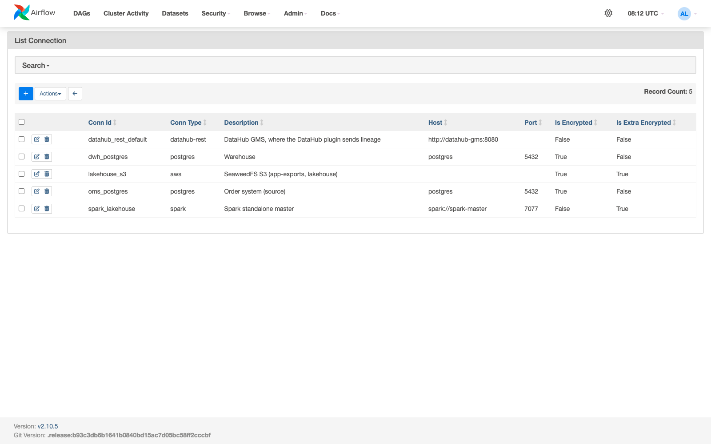

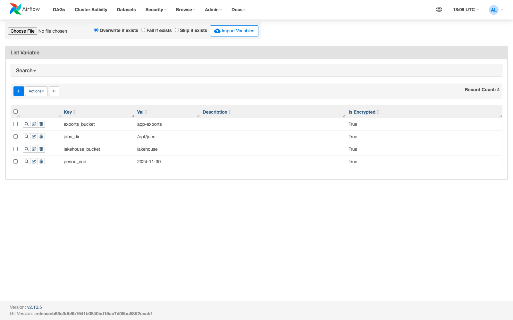

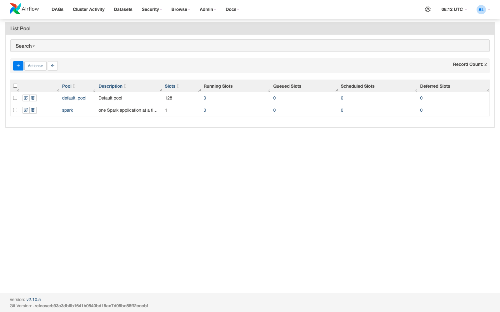

## DAGs

The DAGs build their Spark tasks with one factory, `airflow/dags/lakehouse_tasks.py`:

- **How it submits:** `SparkSubmitOperator` on connection `spark_lakehouse`, in pool `spark`, with
  the job path from variable `jobs_dir`.
- **Credentials, hosts and buckets:** they come from connections and variables in templated
  `env_vars` (`{{ conn.oms_postgres.password }}`, `{{ conn.lakehouse_s3.password }}`,
  `{{ var.value.lakehouse_bucket }}`). A task can add or replace entries (`env=`), as the
  `warehouse` task does for `dwh_postgres`.
- **Spark settings:** `spark.driver.host` is set to `airflow-scheduler`.

The DAGs run from 2024-06-01 to 2024-12-01. The extra last day loads the parcels ordered on
2024-11-30 and delivered after midnight: their order update and their scans belong to 2024-12-01.

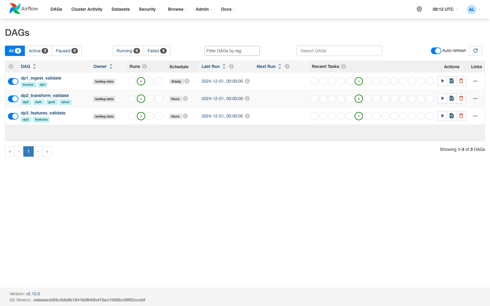

### DP1: `dp1_ingest_validate`

```text
ingest_bronze (jobs/dp1_ingest.py --until {{ ds }})  >>  validate_bronze (jobs/validate.py --suite dp1 --ds {{ ds }} --period-end {{ var.value.period_end }} --fail-on-error)  >>  trigger_dp2
validate_bronze  >>  publish_assertions (the suite's results to DataHub, trigger rule all_done)
```

| Task | What it does | Details |
|---|---|---|
| `ingest_bronze` | copies the `oms` rows changed since bronze's watermark, and the export dates not loaded yet, into the `raw_` Delta tables | [DP1: ingest into bronze](pipelines.md#dp1-ingest-into-bronze-jobsdp1_ingestpy) |
| `validate_bronze` | Great Expectations on day `ds` of bronze (73 expectations): the sources' promises, dirty values included | [DP1: validate bronze](pipelines.md#dp1-validate-bronze-jobsvalidatepy---suite-dp1) |
| `publish_assertions` | sends the suite's results to DataHub as assertions, whether the suite passed or failed | [datahub.md](datahub.md) |
| `trigger_dp2` | starts `dp2_transform_validate` for the same day, only after `validate_bronze` passed | |

`validate_bronze` fails the run when any expectation fails, so nothing after it runs on bad
bronze. For a day after `period_end`, the DP1 suite skips the pings slice, which has no rows then
(45 of its 73 expectations remain). The DP2 and DP3 suites skip their ping, activity, fact and
hub-hour slices in the same way.

**Check on the dev slice (2026-10-23).** Bronze's rows from local 2024-11-29 on were deleted with a
Delta `DELETE`, so the DAG had real work to do. (The deleted rows stay in the table's history, and
the sources still hold them.) Then three runs were triggered:

| Run | `ingest_bronze` | `validate_bronze` | Result |
|---|---|---|---|
| 2024-11-29 | +12,012 orders, +9 couriers and courier changes, +43 customers, +1 ping and +1 scan export date (29 s) | 73 of 73 (33 s) | success |
| 2024-11-30 | the next day (31 s) | 73 of 73 (34 s) | success |
| 2024-12-01 | the 2,519 orders and 2,838 scans changed after midnight | first run: failed. 72 of 73, because there are no pings after the period. After the period-end rule: 45 of 45 | success after the fix |

After the runs, bronze equals the sources again: 808,000 orders, 49,350,264 pings, 2,424,000
scans, 200 couriers, 1,093 courier changes and 50,000 customers. The 5.7 MB of task logs contain
neither the Postgres password nor the S3 secret key.

The grid holds DP1's six runs, all green. The graph shows the run for 2024-12-01:

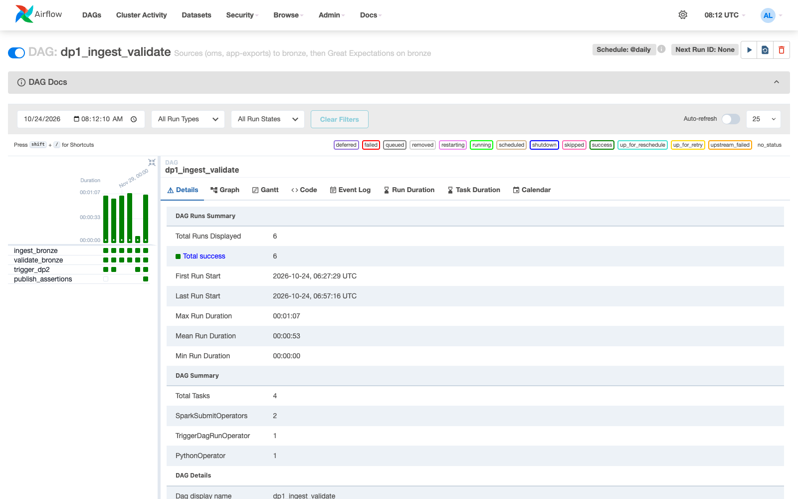

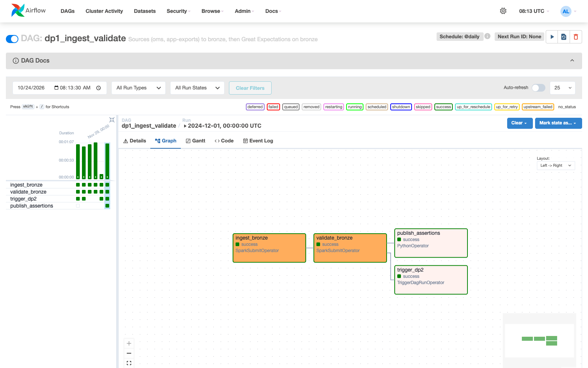

### DP2: `dp2_transform_validate`

DP2 has no schedule. `dp1_ingest_validate` starts it for the same logical date
(`TriggerDagRunOperator`), and only after `validate_bronze` passed.

```text
ingest stage:   silver >> gold_dims >> gold_facts >> warehouse
validate stage: >> [validate_suite (jobs/validate.py --suite dp2 --ds {{ ds }} ...), validate_scd2 (jobs/check_dim_courier.py)]
                >> trigger_dp3
validate_suite >> publish_assertions (the suite's results to DataHub, trigger rule all_done)
```

| Task | What it does | Details |
|---|---|---|
| `silver` | cleans the new bronze rows into the `stg_` tables: merges `oms` changes, dedups the re-uploaded pings, and compacts each new ping date | [DP2: silver](pipelines.md#dp2-clean-bronze-into-silver-jobsdp2_silverpy) |
| `gold_dims` | builds the dimensions, and merges the courier changes into the SCD2 `dim_courier` | [DP2: gold dimensions](pipelines.md#dp2-gold-dimensions-jobsdp2_gold_dimspy) |
| `gold_facts` | merges `fact_delivery` and adds the new hours of `fact_courier_activity_hourly`, with the NULL-isolation join for `late_trip_min` | [DP2: gold facts](pipelines.md#dp2-gold-facts-jobsdp2_gold_factspy) |
| `warehouse` | loads the star schema into `dwh` staging, then swaps it in one transaction | [DP2: warehouse](pipelines.md#dp2-load-the-warehouse-jobsdp2_warehousepy) |
| `validate_suite` | Great Expectations on day `ds` of silver and gold (62 expectations) | [DP2: validate](pipelines.md#dp2-validate-silver-and-gold-jobsvalidatepy---suite-dp2) |
| `validate_scd2` | checks the SCD2 invariants of `dim_courier` against the change audit | [`dim_courier`, SCD type 2](pipelines.md#dim_courier-scd-type-2) |
| `publish_assertions` | sends the suite's results to DataHub as assertions, pass or fail | [datahub.md](datahub.md) |
| `trigger_dp3` | starts `dp3_features_validate` for the same day, only after both checks passed | |

**Check on the dev slice (2026-10-23).** A run of `dp1_ingest_validate` for 2024-11-30 passed its
three tasks and triggered `dp2_transform_validate` for the same day. All six DP2 tasks succeeded
in 3.5 minutes:

| Task | Time | Output |
|---|---:|---|
| `silver` | 38 s | `stg_orders` 808,000, `stg_courier_changes` 1,093, `stg_customers` 50,000; no new ping or scan export date |
| `gold_dims` | 32 s | `dim_zone` 1,497, `dim_customer` 50,000; `dim_courier`: no new version after change 1093 |
| `gold_facts` | 36 s | `fact_delivery` 808,000 (merged); no new activity hour |
| `warehouse` | 38 s | `dwh` reloaded: `fact_delivery` 408,000, `obt_delivery` 168,000, the dimensions |
| `validate_suite` | 46 s | 61 of 61 expectations passed |
| `validate_scd2` | 23 s | 8 invariants, 0 violations: 799 versions from 1,093 audit rows |

The first try of the DP1 run failed at `trigger_dp2` ("Dag id dp2_transform_validate not found").
The scheduler looks for new DAG files every 300 s by default, and the run started seconds after the
file was added. `AIRFLOW__SCHEDULER__DAG_DIR_LIST_INTERVAL` is now 30 s. After clearing the task,
the run passed.

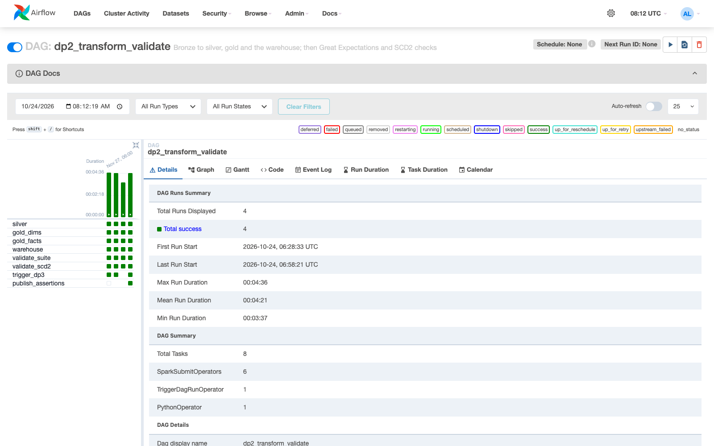

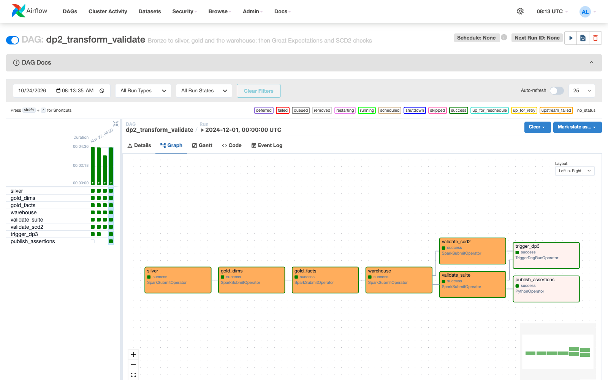

### DP3: `dp3_features_validate`

DP3 has no schedule either. `dp2_transform_validate` starts it for the same day once both of its
checks passed.

```text
ingest stage:   features (jobs/dp3_features.py --incremental: only what the facts' Change Data Feed changed)
validate stage: >> [validate_suite (jobs/validate.py --suite dp3 --ds {{ ds }} ...), validate_incremental (jobs/check_cdf.py)]
                >> checks_passed
validate_suite >> publish_assertions (the suite's results to DataHub, trigger rule all_done)
```

| Task | What it does | Details |
|---|---|---|
| `features` | recomputes and merges only the feature rows whose couriers, hubs and zones the facts' Change Data Feed touched | [DP3: features](pipelines.md#dp3-offline-feature-tables-jobsdp3_featurespy), [novel_cdf_incremental.md](novel_cdf_incremental.md) |
| `validate_suite` | Great Expectations on day `ds` of the three `feat_` tables (31 expectations) | [DP3: validate](pipelines.md#dp3-validate-the-feature-tables-jobsvalidatepy---suite-dp3) |
| `validate_incremental` | compares every incremental feature table with a full recompute | [novel_cdf_incremental.md](novel_cdf_incremental.md) |
| `publish_assertions` | sends the suite's results to DataHub as assertions, pass or fail | [datahub.md](datahub.md) |
| `checks_passed` | succeeds only when both checks passed, so the run's state is the checks' result | |

**Why `checks_passed`.** Airflow sets a run's state from its last tasks. DP1 and DP2 end in a
trigger task that runs only when their checks passed, so a failed check fails the run. DP3 has no
next DAG, and `publish_assertions` succeeds even after a failed suite, so a failed suite used to
leave the run green. `checks_passed` (an `EmptyOperator`) runs only when both checks passed: a
failed check now marks it `upstream_failed`, and the run fails.

`validate_incremental` compares every incrementally maintained feature table with a full
recompute, so each run also checks novel idea 2 ([novel_cdf_incremental.md](novel_cdf_incremental.md)).

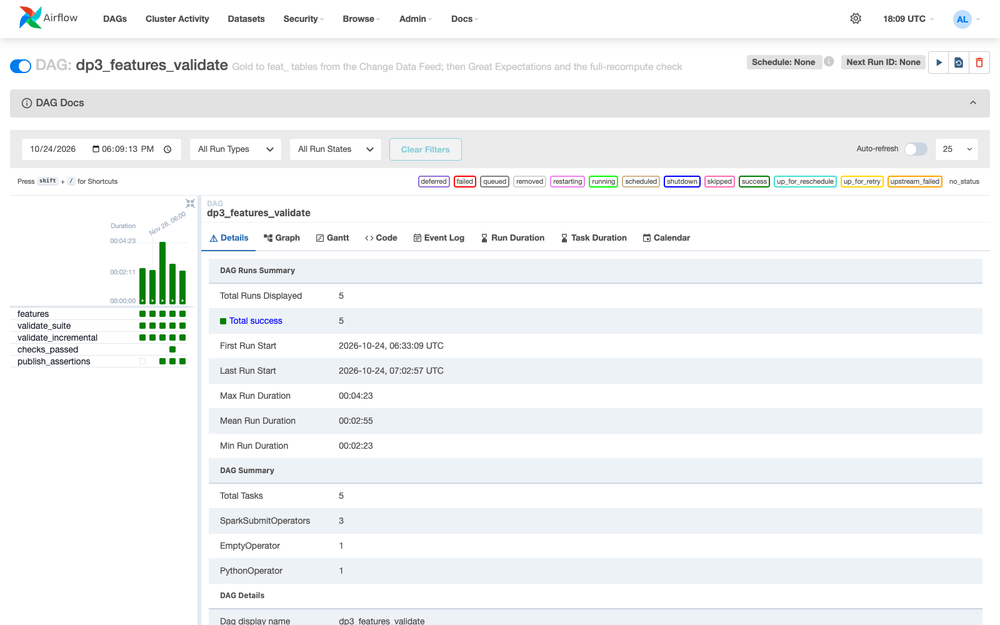

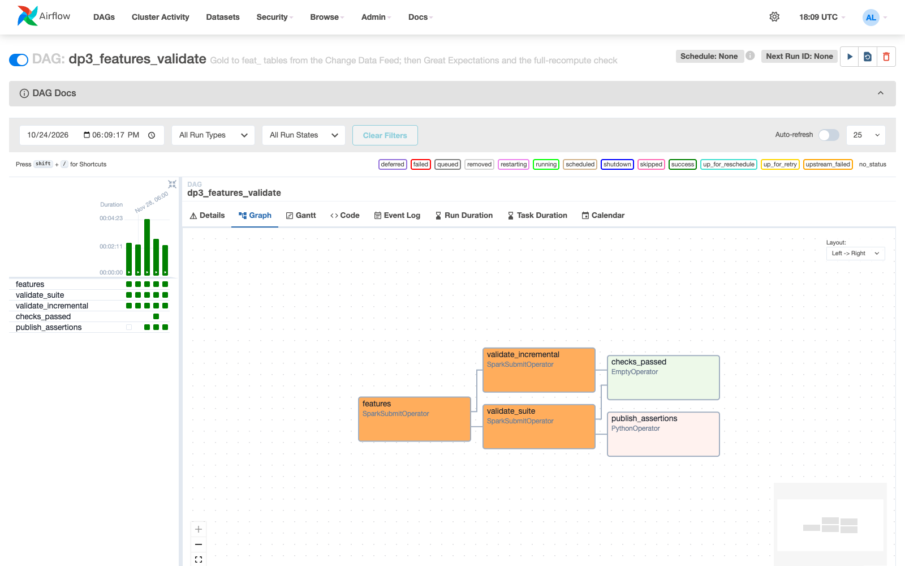

### The whole chain

```text
dp1_ingest_validate ──trigger_dp2──► dp2_transform_validate ──trigger_dp3──► dp3_features_validate
  (bronze must pass)                   (silver and gold must pass)
```

**Check on the dev slice (2026-10-23).** One trigger of `dp1_ingest_validate` for 2024-11-28 ran
the whole chain green. DP1 finished after 66 s, DP2 (triggered by DP1) after 5.7 min, and DP3
(triggered by DP2) after 8.1 min. The run for 2024-12-01, the day after the period, is green too:
the DP3 suite passed 19 of 19, skipping only the hub-hour slice, which holds just that day's
closing hour.

### Run after the 100 GB work (2026-10-24)

After the Spark optimizations, two DP2 jobs changed:

- `gold_facts` joins pings to `fact_delivery` for `late_trip_min`, with the NULL trip ids kept out
  of the shuffle;
- `silver` compacts each new ping date, ordered by courier
  ([spark_optimization.md](spark_optimization.md), [storage_optimization.md](storage_optimization.md)).

The facts were rebuilt once for the new column. Then DP2 was triggered for 2024-11-29 (12:00 UTC),
and it triggered DP3:

```bash
docker compose exec airflow-scheduler airflow dags trigger dp2_transform_validate -e 2024-11-29T12:00:00+00:00
```

DP1 was not run. After the full-scale generation, `oms` and `app-exports` hold the 100 GB sources,
while the lakehouse holds the slice. DP1 would copy every full-scale row changed after bronze's
watermark into the slice's bronze. DP2 reads bronze, so it ran on the slice as before.

| DAG | Task | Time | Result |
|---|---|---:|---|
| `dp2_transform_validate` (266 s) | `silver` | 33.6 s | no new export date, so nothing to compact |
| | `gold_dims` | 37.8 s | |
| | `gold_facts` | 41.9 s | `fact_delivery` 808,000 rows; no new ping date |
| | `warehouse` | 50.7 s | `dwh.fact_delivery` 408,000, `obt_delivery` 168,000, with the three indexes |
| | `validate_suite` | 63.6 s | 62 of 62, the new `late_trip_min` check included |
| | `validate_scd2` | 30.8 s | 799 versions from 1,093 audit rows; 0 violations |
| | `publish_assertions` | 4.3 s | 62 assertions sent to DataHub, 0 failed |
| `dp3_features_validate` (264 s) | `features` | 143.7 s | the rebuild rewrote every fact row, so the Change Data Feed listed them all |
| | `validate_suite` | 34.7 s | 31 of 31 |
| | `validate_incremental` | 81.2 s | 0 differences from a full recompute |
| | `publish_assertions` | 1.1 s | 31 assertions sent to DataHub, 0 failed |

DataHub's Trino recipe ran again afterwards. `fact_courier_activity_hourly` now shows
`late_trip_min` in its schema, and 6 assertions instead of 5.

**At full scale.** DP2 runs one day at a time. The pieces that grow with the data were measured
at 100 GB ([spark_optimization.md](spark_optimization.md),
[storage_optimization.md](storage_optimization.md)). The projection for one full-scale day assumes
that the ping part of the cost grows with the rows:

| Step | Measured at full scale | One full-scale day (projected) |
|---|---|---:|
| ping dedup (window) | 73.3 s for 7 days | about 10 s |
| pings LEFT JOIN trips, NULL isolation | 1,148 s for 183 days; 294 s in the one-day trial ([spark_optimization.md](spark_optimization.md#the-choice-for-the-pipeline)) | 2 to 5 min: the join shuffles all 80.8 million orders every day, which is most of the one-day trial's time; the pings add about 6 s |
| compaction and Z-order of the new pings | 443 s for 7 days | about 63 s |

A daily DP2 at full scale therefore adds minutes, not hours, to the slice's 4.4 minutes. A full
rebuild of 183 days would take hours: about 19 minutes for the join alone, and about 3 hours for
compacting the whole history. That is what the 100 GB runs measured.

### Run after the review fixes (2026-10-24)

The review fixes changed how the tasks get their settings (the buckets and both JDBC URLs from
Airflow), DP2's lineage lists, and DP3's last task (`checks_passed`). DP2 was triggered for
2024-11-30 (12:00 UTC), and it triggered DP3; DP1 was not run, for the reason above.

```bash
docker compose exec airflow-scheduler airflow dags trigger dp2_transform_validate -e 2024-11-30T12:00:00+00:00 -r manual__review_fixes_2024-11-30
```

| DAG | Task | Time | Result |
|---|---|---:|---|
| `dp2_transform_validate` (green) | `silver` | 29.5 s | `stg_orders` 808,000 rows; no new ping or scan export date |
| | `gold_dims` | 34.7 s | `dim_zone` 1,497 rows; `dim_courier`: no new version after change 1093 |
| | `gold_facts` | 47.3 s | `fact_delivery` 808,000 rows; no new ping date |
| | `warehouse` | 54.9 s | written through `dwh_postgres`: `fact_delivery` 408,000, `obt_delivery` 168,000, `dim_courier` 799 |
| | `validate_suite` | 72.7 s | 62 of 62 |
| | `validate_scd2` | 31.3 s | 799 versions from 1,093 audit rows; 0 violations |
| | `publish_assertions` | 1.8 s | 62 assertions sent to DataHub, 0 failed |
| `dp3_features_validate` (green) | `features` | 27.1 s | the Change Data Feed listed 0 changed fact rows, so no feature row changed |
| | `validate_suite` | 39.5 s | 31 of 31 |
| | `validate_incremental` | 101.0 s | 0 differences from a full recompute: 33,836, 175,760 and 275,448 rows |
| | `checks_passed` | 0 s | both checks passed |
| | `publish_assertions` | 1.2 s | 31 assertions sent to DataHub, 0 failed |

DataHub's lineage after this run is in [datahub.md](datahub.md#checks-after-the-lineage-fix-2026-10-24).

### Failure drill: a corrupted batch blocks everything downstream

The drill was run on 2026-10-23 against the order system.

1. **Back up `oms`.** `pg_dump` (35 MB).
2. **Insert a corrupted batch.** 100 orders copied from real 2024-12-01 orders, with new ids
   (9000001 to 9000100), a traffic code the system never used (`"Gridlock "`), status `lost`, and
   an `updated_ts` after bronze's watermark.
3. **Rerun DP1 for 2024-12-01** (clearing its run).
   - `ingest_bronze` succeeded: `bronze.raw_orders: +100 rows`.
   - `validate_bronze` **failed**: 43 of 45. `traffic` and `status` were out of their value sets
     for 100 of 2,619 rows each (3.82%).
   - `trigger_dp2` was `upstream_failed`.
4. **Check downstream.** No new DP2 run started (still 1) and no DP3 run (still 0). Silver,
   gold, the warehouse and the features never saw the batch.
5. **Repair.** The rows were deleted from `oms` and from bronze (Delta keeps the bad version in its
   history). After clearing the DP1 run:
   - DP1 passed and triggered DP2;
   - DP2 passed and triggered DP3;
   - DP3 passed: `features` read 0 changed fact rows, `validate_incremental` found 0 differences,
     and the suite passed 19 of 19.

The failed `validate_bronze` still wrote its results
(`s3a://lakehouse/_validation/dp1/ds=2024-12-01/results.json`) before the run stopped, and
`publish_assertions` sends them to DataHub even when the suite fails
([datahub.md](datahub.md#data-validation-great-expectations-results-as-assertions)).

`validate_bronze` for 2024-12-01 keeps every try. Try 1 failed before the period-end rule existed;
tries 3 and 5 are the two drills, and each repair after them passed (tries 4 and 6):

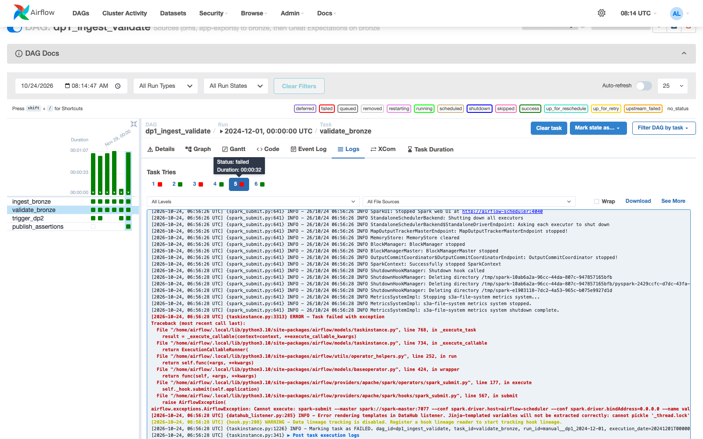

The log of try 5 holds the two failed expectations:

```text
FAIL bronze.raw_orders expect_column_values_to_be_in_set {'column': 'traffic'} observed {'element_count': 2619, 'unexpected_count': 100, 'unexpected_percent': 3.8182512409316534}
FAIL bronze.raw_orders expect_column_values_to_be_in_set {'column': 'status'} observed {'element_count': 2619, 'unexpected_count': 100, 'unexpected_percent': 3.8182512409316534}
suite dp1 ds 2024-12-01: 43 of 45 expectations passed; results in s3a://lakehouse/_validation/dp1/ds=2024-12-01/results.json; skipped after the period: ['bronze.raw_courier_pings']
```

## Pitfalls

- **A run after `end_date` checks nothing.** A run whose logical date is later than the DAG's
  `end_date` gets no task instances and is marked success. The first drill run (2024-12-01
  20:00 UTC, after the 00:00 `end_date`) did exactly that, so it was deleted and the drill reused
  the 2024-12-01 run.
- **The Change Data Feed of an unchanged fact.** Delta refuses a starting version past the table's
  latest one. DP3 failed once when only `fact_delivery` had a new version. It now reads an empty
  frame for a fact without one.
- **Never print connections as URIs.** `airflow connections list` prints the password in plain
  text unless the output is filtered, as above.
- **New mounted folders after a merge.** Before a feature branch is merged, `git checkout develop`
  deletes a folder that only the feature branch has (here `airflow/`), and the merge creates it
  again as a new folder. Containers that mounted it then see an empty folder until they are
  recreated (`up -d --force-recreate`).
- **A new module in the DAG folder needs a scheduler restart.** The DAG files import
  `datahub_assertions.py`, which was added while the scheduler ran. Its DAG processor did not see
  the new file: every DAG file failed with `ModuleNotFoundError: No module named
  'datahub_assertions'`, the three DAGs were deactivated, and a triggered run stayed `queued`.
  `airflow tasks test` worked because it starts a fresh process. `docker compose restart
  airflow-scheduler airflow-webserver` fixed it.
- **`--profile orch` alone is not enough,** like `batch`: Airflow needs Postgres from `core` and
  the Spark cluster from `batch`.
