# DataHub: the platform's catalog, lineage and data quality

DataHub v1.5.0.6 holds the schema of every table in every zone. It also holds the lineage of the
Airflow pipelines DP1 to DP3 and the result of every Great Expectations check that those pipelines
run.

## Services (profile `gov`)

| Service | Image | Role | Port on the Mac | Memory |
|---|---|---|---|---|
| `opensearch` | `opensearchproject/opensearch:2.19.7` | search and graph index (security plugin off: local only) | | heap 512 MB, 1.09 GiB in use |
| `datahub-system-update` | `acryldata/datahub-upgrade:v1.5.0.6` | one-shot: SQL schema in the `datahub` database, search indices, Kafka topics | | heap 512 MB |
| `datahub-gms` | `acryldata/datahub-gms:v1.5.0.6` | metadata service: REST and GraphQL API, internal schema registry, Kafka consumers | `127.0.0.1:8083` | heap 1 GB, 958 MiB in use |
| `datahub-frontend` | `acryldata/datahub-frontend-react:v1.5.0.6` | the UI | `127.0.0.1:9002` (user `datahub`, password `DATAHUB_ADMIN_PASSWORD` in `.env`) | heap 512 MB, 464 MiB in use |

`gov` runs on top of `core`. The metadata is in the `datahub` database of the shared Postgres,
and DataHub's event topics are in the core Kafka.

```bash
docker compose --profile core --profile gov up -d --wait
```

When `core`, `batch`, `query`, `orch` and `gov` all run, the containers use 9.1 GiB of the
16 GB VM.

**Settings that matter.** They come from the reference project and DataHub's quickstart:

- **Schema-registry flags.** `SCHEMA_REGISTRY_SYSTEM_UPDATE` and the auto-register flags are set
  on the system-update job only. If they are set on GMS too, its Kafka consumers stop and
  nothing gets indexed.
- **`ES_BULK_REFRESH_POLICY: NONE`.** Indexing does not wait for a refresh on every bulk write.
- **Topics.** The setting is `DATAHUB_PRECREATE_TOPICS: "true"`, because the broker does not
  auto-create topics.
- **Login.** The frontend writes `user.props` from `DATAHUB_ADMIN_PASSWORD` when it starts, so no
  password file is in the repo.
- **Authentication.** The setting is `METADATA_SERVICE_AUTH_ENABLED: "false"`, because GMS listens
  only on `127.0.0.1` and the compose network.
- **Heaps.** They are set on every JVM. GMS ships without a heap setting. Without one, it would
  take 25% of the VM ([environment.md](environment.md)).

## Schema ingestion (`datahub/recipes/`)

The recipes run from the Mac with the DataHub CLI. The credentials come from the environment (here
`.env`), so no recipe holds a secret:

```bash
set -a; . ./.env; set +a
uvx --python 3.11 --from 'acryl-datahub[trino,postgres,kafka]==1.5.0.17' datahub ingest -c datahub/recipes/trino_lakehouse.yml
uvx --python 3.11 --from 'acryl-datahub[trino,postgres,kafka]==1.5.0.17' datahub ingest -c datahub/recipes/postgres.yml
uvx --python 3.11 --from 'acryl-datahub[trino,postgres,kafka]==1.5.0.17' datahub ingest -c datahub/recipes/kafka.yml
```

| Recipe | Reads | Datasets |
|---|---|---|
| `trino_lakehouse.yml` | Trino catalog `delta`, schemas `bronze`, `silver`, `gold` (the bookkeeping table `dp3_progress` excluded) | 7 bronze, 6 silver, 10 gold |
| `postgres.yml` | databases `oms` (the source) and `dwh` (the warehouse), schema `public` | 5 `oms`, 7 `dwh` |
| `kafka.yml` | the platform's 4 topics; DataHub's own event topics on the same broker are excluded | 4 |

**URNs.** A lakehouse table's dataset URN (uniform resource name) is
`urn:li:dataset:(urn:li:dataPlatform:trino,delta.<zone>.<table>,PROD)`, for example
`delta.bronze.raw_orders`. The Airflow lineage uses the same URNs, so the lineage lands on the
datasets that these recipes ingested.

### Checks (2026-10-23)

- The system-update job completed 36 of 36 steps ("Upgrade SystemUpdate completed with result
  SUCCEEDED").
- GMS and the frontend were healthy 54 s after `up`.
- Every recipe finished without failures:
  - Trino: 24 tables scanned, 117 events;
  - Postgres: 12 tables, 70 events;
  - Kafka: 4 topics, 22 records. Its warning says that the topics have no registered schema.

A GraphQL search on GMS (`searchAcrossEntities`) lists the datasets by platform and zone:

| Platform | Zone | Datasets |
|---|---|---:|
| postgres | `oms` (source) | 5 |
| kafka | topics | 4 |
| trino | bronze | 7 |
| trino | silver | 6 |
| trino | gold | 10 |
| postgres | `dwh` | 7 |

The screenshots show every zone in the UI, one schema per zone:

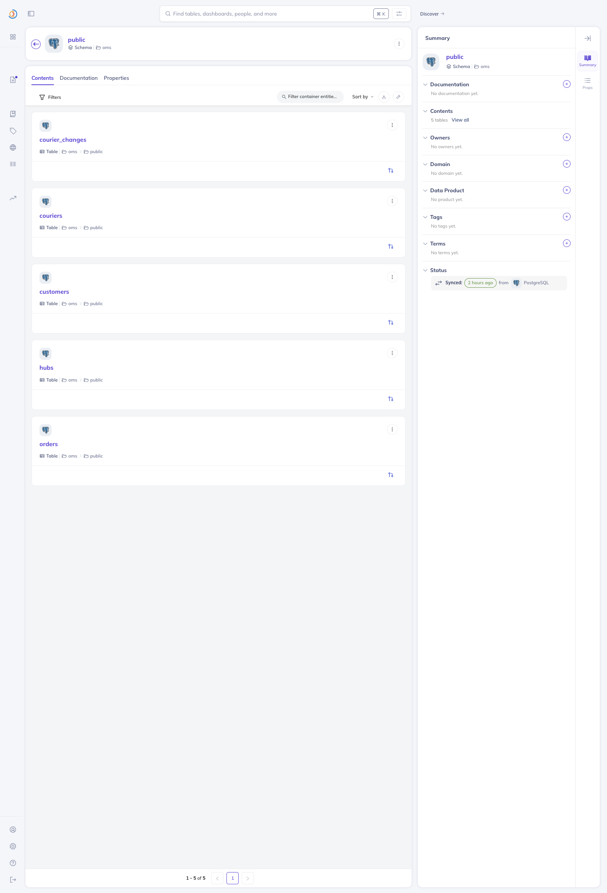

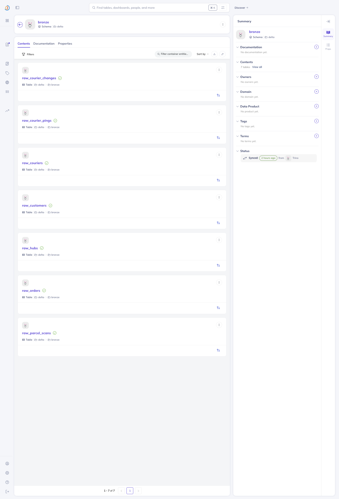

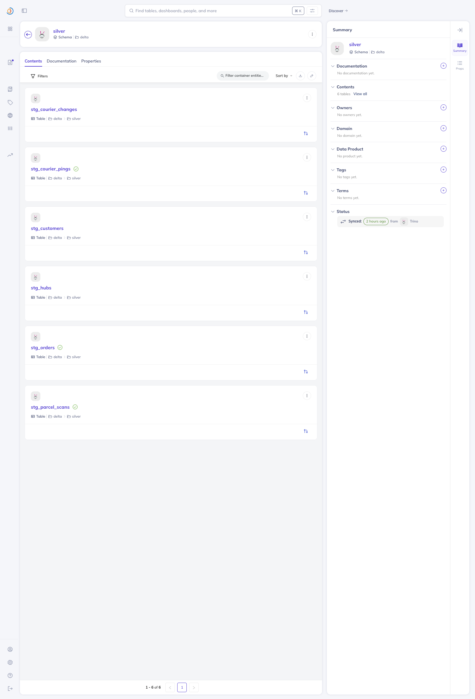

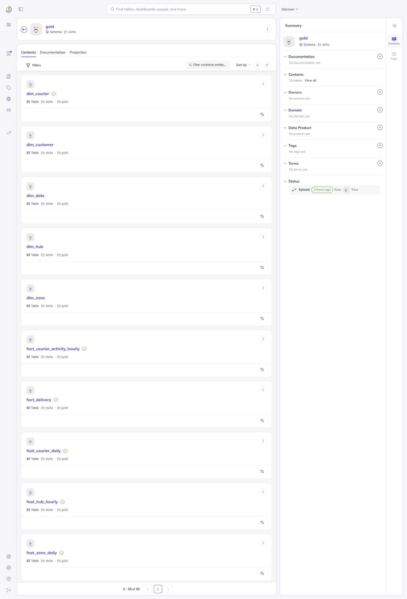

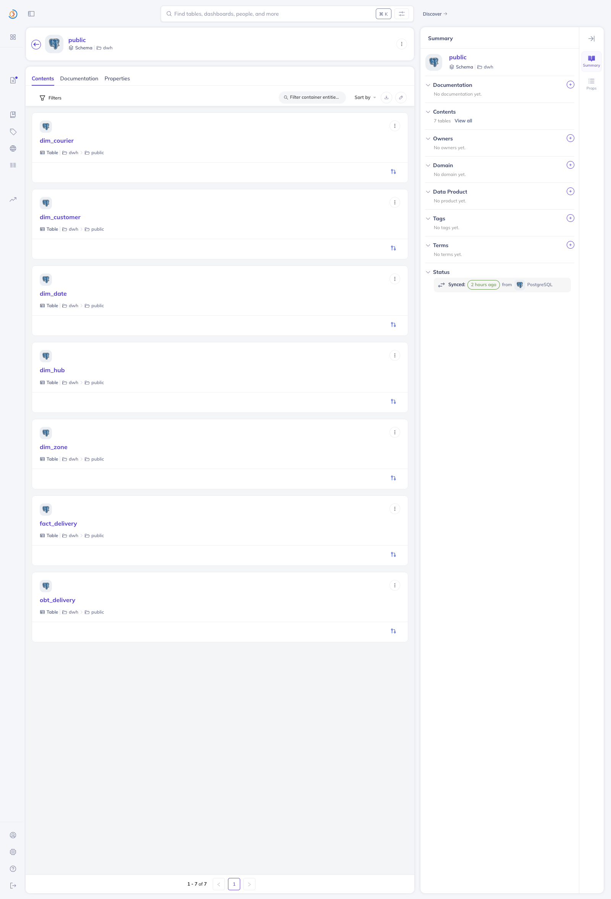

The next screenshot shows the schema of one table, here `delta.gold.fact_delivery`:

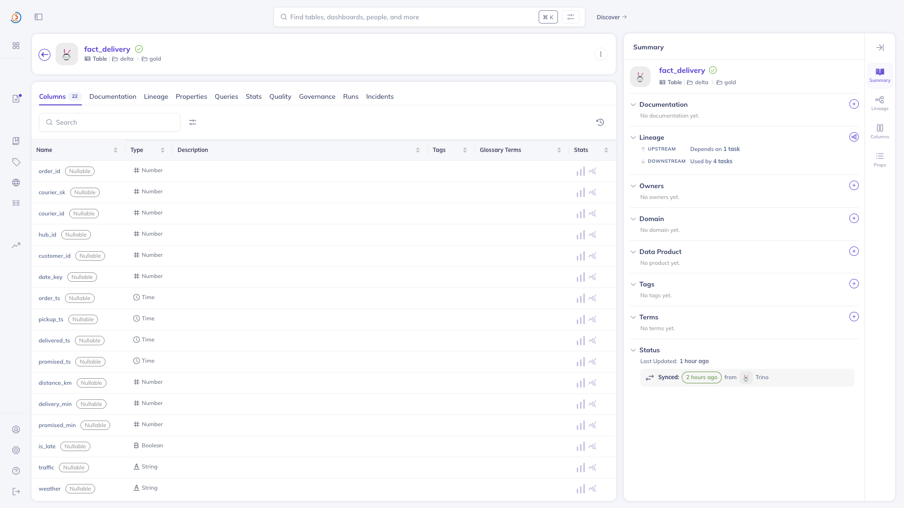

## Lineage from Airflow

When a task runs, the DataHub Airflow plugin (`acryl-datahub-airflow-plugin` 1.5.0.17, in the
Airflow image) sends each pipeline and task to GMS:

- a DAG becomes a DataFlow, and a task becomes a DataJob of that flow;
- a task's `inlets` and `outlets` become the DataJob's inputs and outputs.

Spark jobs have no lineage that the plugin can read, so every `SparkSubmitOperator` declares its
datasets. The helpers in `airflow/dags/lakehouse_tasks.py` build them with the URNs that the
recipes ingested:

| Helper | Dataset URN name | Example |
|---|---|---|
| `lake(zone, *tables)` | `trino`, `delta.<zone>.<table>` | `delta.silver.stg_orders` |
| `postgres(db, *tables)` | `postgres`, `<db>.public.<table>` | `oms.public.orders`, `dwh.public.fact_delivery` |
| `exports(*datasets)` | `s3`, `app-exports/<dataset>` | `app-exports/courier_pings` |

| DAG | Task | Inputs | Outputs |
|---|---|---|---|
| `dp1_ingest_validate` | `ingest_bronze` | 5 `oms` tables, 2 app exports | 7 bronze tables |
| | `validate_bronze` | 7 bronze tables | |
| `dp2_transform_validate` | `silver` | 6 bronze tables (not `raw_couriers`: `dim_courier` is built from the courier changes) | 6 silver tables |
| | `gold_dims` | `stg_hubs`, `stg_customers`, `stg_courier_changes` | 5 dimensions |
| | `gold_facts` | `stg_orders`, `stg_courier_pings`, `dim_courier`, `dim_hub` | 2 facts |
| | `warehouse` | 5 dimensions, `fact_delivery` | 7 `dwh` tables |
| | `validate_suite`, `validate_scd2` | the tables they check (the suite: 3 silver tables, 5 dimensions, 2 facts) | |
| `dp3_features_validate` | `features` | 2 facts, 4 dimensions | 3 `feat_` tables |
| | `validate_suite`, `validate_incremental` | the tables they check | |

The validate tasks have inputs only: they read tables and write nothing back. The Airflow connection
`datahub_rest_default` points the plugin at `http://datahub-gms:8080`. To run Airflow without the
`gov` profile, set `DATAHUB_ENABLED=false`.

### Checks (2026-10-23)

The chain ran for 2024-11-27 with the plugin on: DP1 in 67 s, DP2 at 346 s, DP3 at 496 s, all
green. Then a GraphQL query on GMS returned:

- 3 DataFlows and 13 DataJobs. Each Spark task has the inputs and outputs in the table above, and
  the two trigger tasks have no inputs or outputs. Each DAG got its `publish_assertions` task
  later (below), so the pipelines now have 16 tasks, and the screenshots show them.
- An upstream lineage search from `dwh.public.fact_delivery` reaches every zone back to the
  sources. It finds 6 gold, 5 silver, 7 bronze, the 5 `oms` tables and the 2 app exports. The
  silver table that does not appear is `stg_parcel_scans`, because no gold job reads it.

### Checks after the lineage fix (2026-10-24)

The `silver` task listed all 7 bronze tables as inputs, but `jobs/dp2_silver.py` reads 6: it never
reads `raw_couriers`. The DP2 suite also listed silver tables it does not check. Both lists now
match the code, and the DP3 DAG gained its `checks_passed` task ([airflow.md](airflow.md#dp3-dp3_features_validate)).
After the DP2 and DP3 run for 2024-11-30 (12:00 UTC), the same GraphQL queries returned:

- 3 DataFlows and 17 DataJobs: the 16 tasks above and `checks_passed`.
- `silver`: 6 inputs and 6 outputs. `validate_suite` of DP2: 10 inputs.
- The upstream lineage of `dwh.public.fact_delivery`: 6 gold, 5 silver, 6 bronze, the 5 `oms`
  tables and the 2 app exports. `raw_couriers` is no longer upstream of the warehouse.
- The two `publish_assertions` tasks sent 62 and 31 assertions, and 0 failed.

The screenshots of the DP3 pipeline and the `silver` lineage below were captured after this run.

The UI shows each pipeline with its tasks:

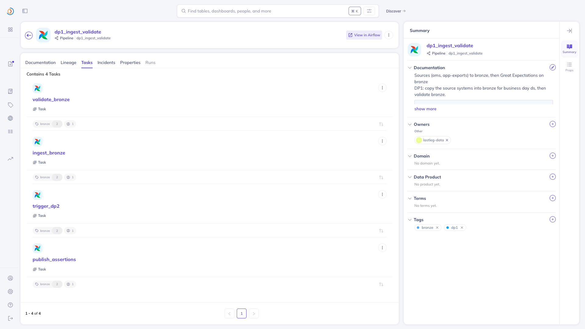

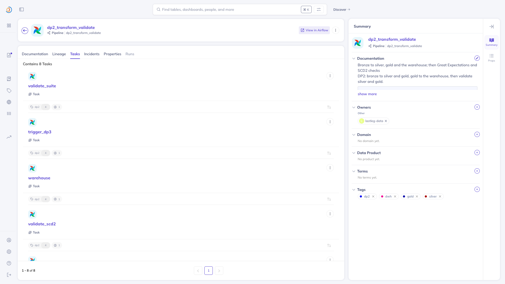

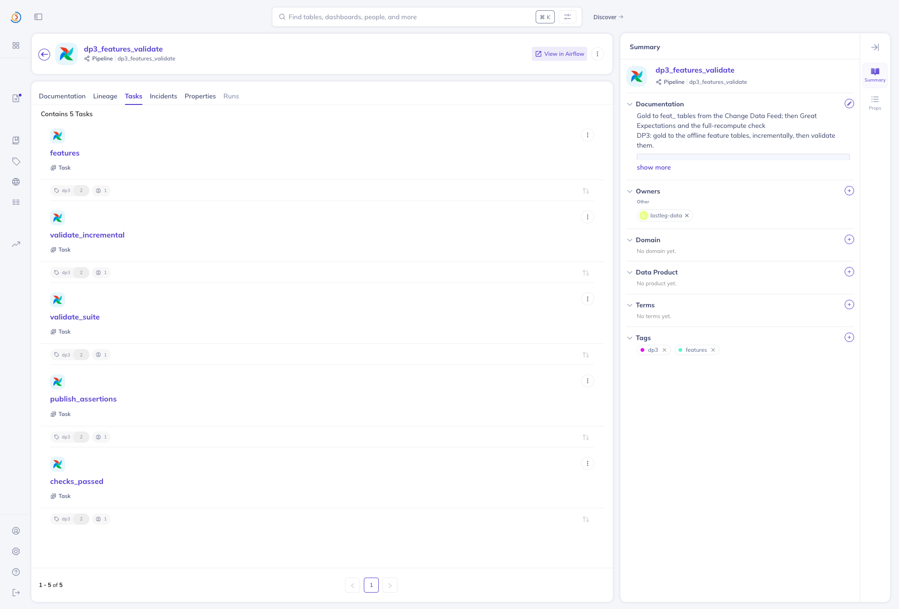

The next screenshots show the lineage of the tasks that write each zone. DP1's `ingest_bronze`
reads the `oms` tables and the two app exports and writes bronze:

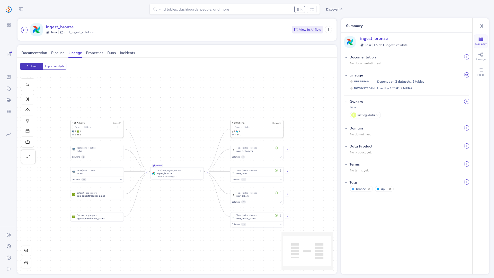

DP2's `silver`, `gold_facts` and `warehouse`:

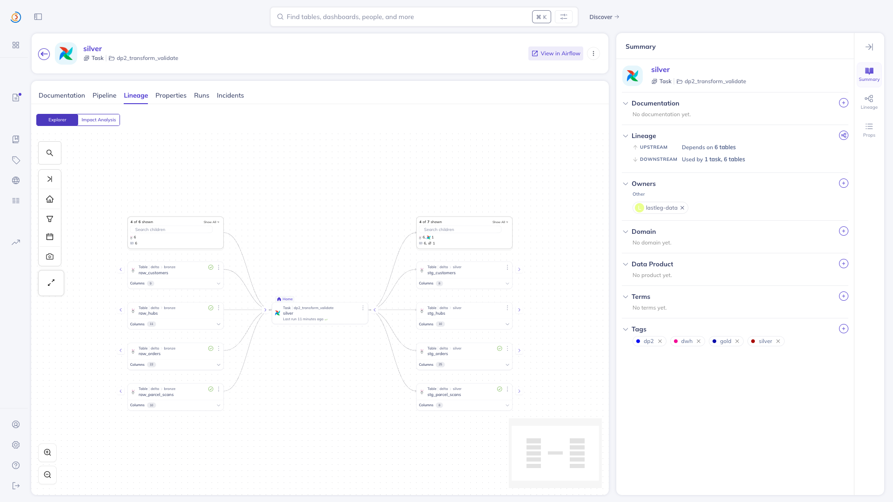

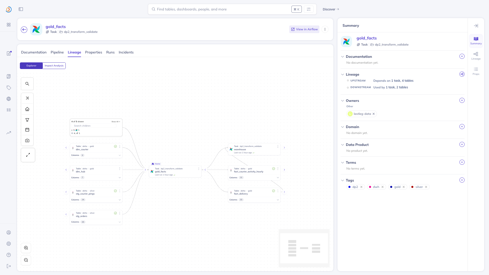

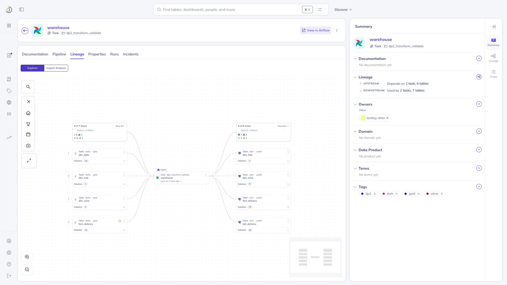

DP3's `features`:

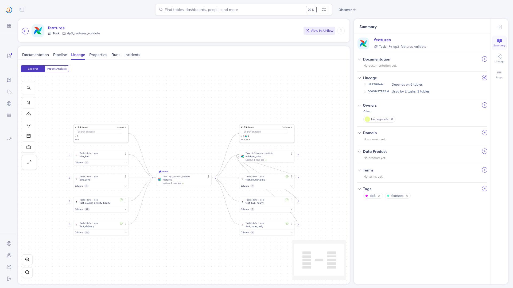

The upstream lineage of `dwh.public.fact_delivery`, through the Airflow tasks back to bronze:

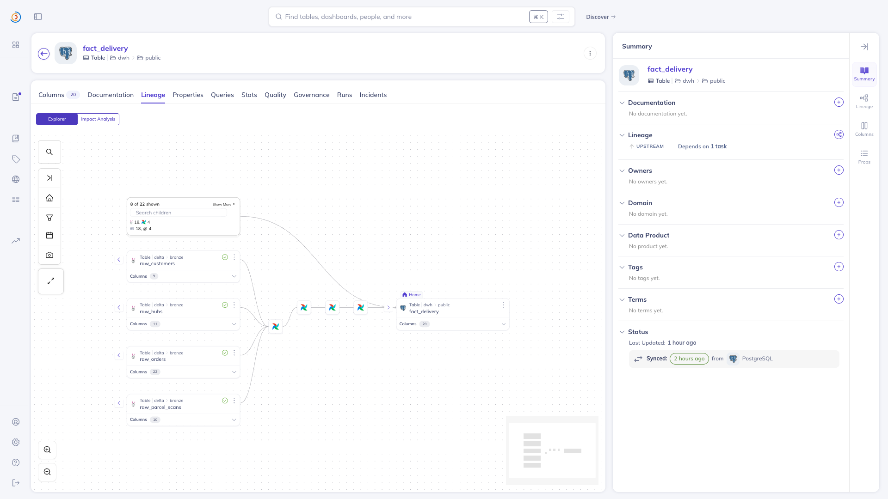

## Data validation: Great Expectations results as assertions

Each pipeline's `validate_suite` task (`validate_bronze` in DP1) writes its results to
`s3a://lakehouse/_validation/<suite>/ds=<ds>/results.json`. The `publish_assertions` task after
it (`airflow/dags/datahub_assertions.py`) sends them to DataHub:

- It sends one assertion per expectation, on the dataset that the expectation checked. The
  assertion's URN is a hash of the suite, the check, the expectation and its arguments. Thus the
  same check is the same assertion in every run. A check on a derived frame, such as
  `gold.fact_delivery labels`, belongs to the table that its name starts with.
- It sends one run event per assertion and run, with partition `ds=<ds>`. The event holds the
  result (`SUCCESS` or `FAILURE`), the rows checked, the unexpected rows and the observed value.

The dataset's **Quality** tab lists the assertions with platform `great-expectations` and the
result of each run.

| Expectation | DataHub scope | Aggregation and operator |
|---|---|---|
| `expect_column_values_to_not_be_null` | column | identity, not null |
| `expect_column_values_to_be_in_set` | column | identity, in |
| `expect_column_values_to_be_unique` | column | unique proportion, equal to 1 |
| `expect_column_values_to_be_between` | column | identity, between |
| `expect_column_mean_to_be_between` | column | mean, between |
| `expect_table_row_count_to_be_between`, `_to_equal` | rows | row count, between, at least or equal to |
| `expect_column_pair_values_A_to_be_greater_than_B` | column (both columns) | native, greater than (or equal to) |
| `expect_compound_columns_to_be_unique` | rows (the key columns) | native |
| `expect_column_to_exist` | schema | native |

The task runs with trigger rule `all_done`, so a failed suite still shows in DataHub. The
trigger to the next pipeline does not depend on it, so a failed suite still stops the chain.
The task skips in two cases:

- the plugin is off (`DATAHUB_ENABLED=false`);
- the suite wrote no results in this run, for example because the ingest before it failed. A
  `results.json` older than the suite's start is from an earlier run, so it is not sent again.

The SCD2 check (`validate_scd2`) and the full-recompute check (`validate_incremental`) are Spark
checks without Great Expectations. If they fail, they stop the chain, but they are not published.

| Pipeline | Datasets with assertions | Assertions |
|---|---|---:|
| DP1 | the 7 bronze tables | 73 |
| DP2 | `stg_orders`, `stg_courier_pings`, `stg_parcel_scans`, `dim_courier`, `fact_delivery`, `fact_courier_activity_hourly` | 62 (61 before the `late_trip_min` check) |
| DP3 | `feat_courier_daily`, `feat_hub_hourly`, `feat_zone_daily` | 31 |

### Checks (2026-10-23)

- **2024-11-27, all green.** The three tasks sent 73, 61 and 31 assertions, 165 in all, and none
  failed. A GraphQL query of each dataset's assertions found them on 16 datasets with platform
  `great-expectations`, each with one run for `ds=2024-11-27`. When the same report was sent
  again, it replaced the run instead of adding one.
- **Later (2026-10-24).** The DP2 suite gained the `late_trip_min` check, so DP2 sends 62
  assertions, and `fact_courier_activity_hourly` has 6 ([airflow.md](airflow.md#run-after-the-100-gb-work-2026-10-24)).
- **The failure drill again, on 2024-12-01** (`oms` backed up first). The same 100 corrupted
  orders as in [airflow.md](airflow.md#failure-drill-a-corrupted-batch-blocks-everything-downstream)
  were inserted and DP1 was rerun:
  - `validate_bronze` failed, `trigger_dp2` was `upstream_failed`, and `publish_assertions`
    succeeded: "45 assertions sent to DataHub, 2 failed";
  - on `delta.bronze.raw_orders`, "traffic takes only allowed values" and "status takes only
    allowed values" each got a `FAILURE` run with 100 unexpected rows.
- **The repair.** The batch was deleted from `oms` and bronze. Then, for 2024-12-01, the chain
  ran green. The tasks sent 45, 30 and 19 assertions, and none failed (the suites skip the
  after-period slices on that day). The two assertions now show three runs: pass, fail, pass.

The UI screenshots show one dataset per pipeline. For DP1, `delta.bronze.raw_orders` has 12
assertions, and all of them pass after the repair. The history of "traffic takes only allowed
values" shows the drill. The assertion passed on 2024-11-27, failed at the drill and passed after
the repair.

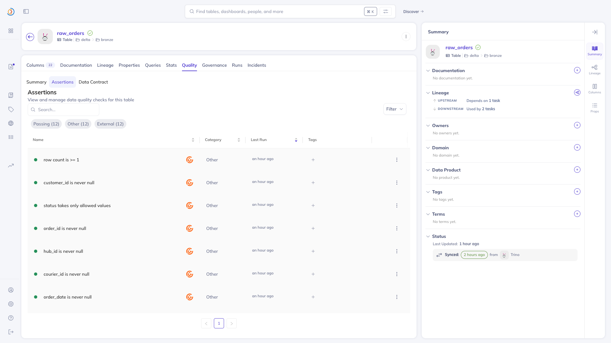

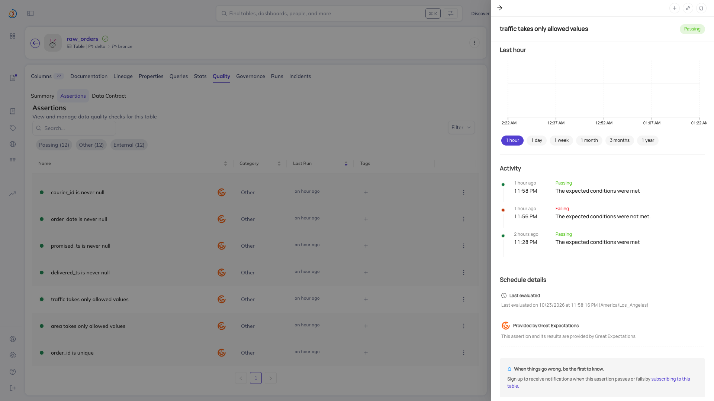

DP2, `delta.silver.stg_orders`, and DP3, `delta.gold.feat_courier_daily`:

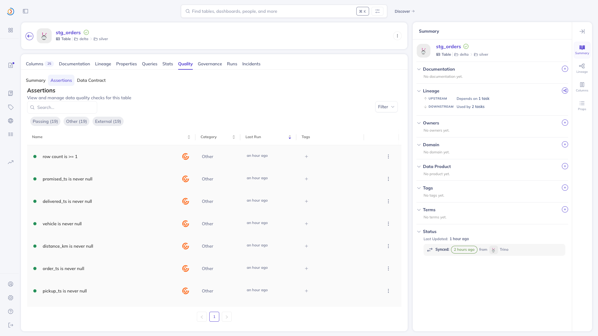

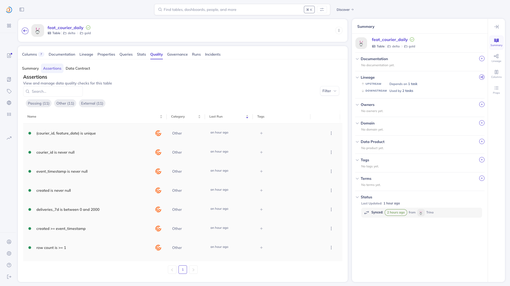

## Pitfalls

- **Recipe patterns match from the start of the name.** A deny pattern of `\.dp3_progress$` let
  the table through. The pattern `.*\.dp3_progress$` excludes it. The entry already ingested was
  soft-deleted with `datahub delete --soft`.
- **Port 8080 on the Mac is the Spark master UI,** so GMS is on 8083.
- **`UNIQUE_PROPORTION` breaks the Quality tab.** The Python SDK has both `UNIQUE_PROPORTION` and
  the misspelled `UNIQUE_PROPOTION`, but the GraphQL API only knows `UNIQUE_PROPOTION`. With the
  correct spelling, GMS stored the assertions, but every GraphQL query of the dataset's assertions
  failed (`No enum constant ... UNIQUE_PROPORTION`).
