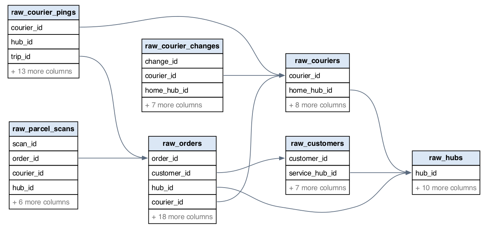
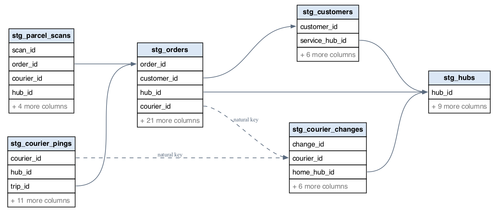
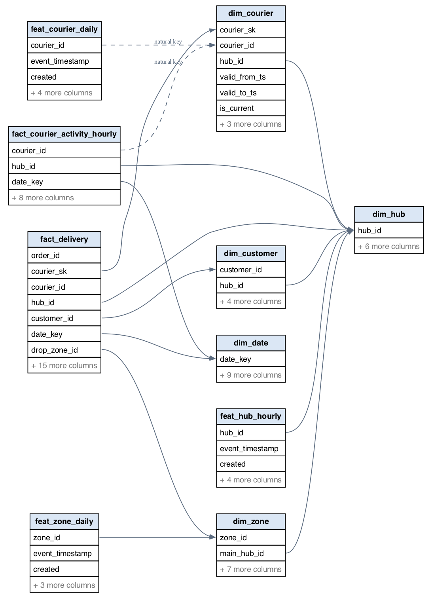
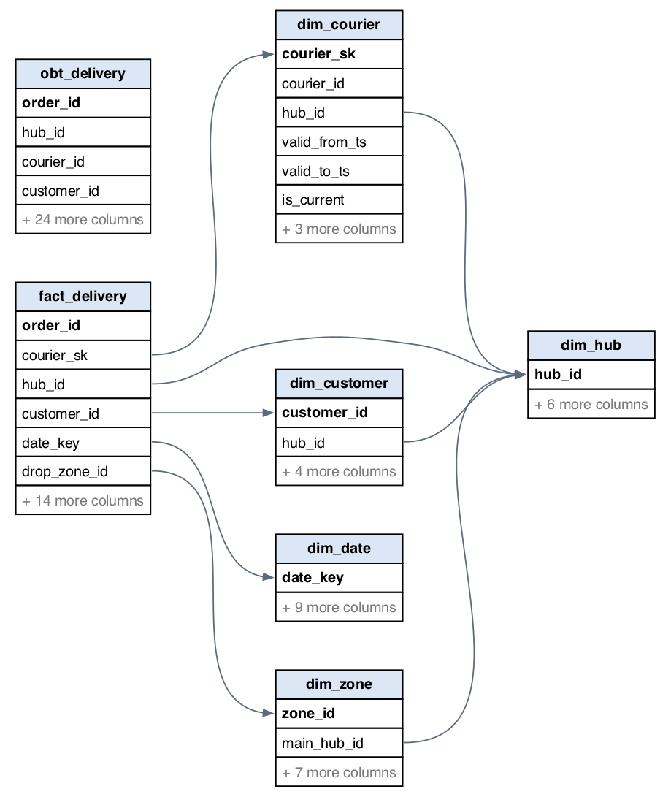

# Schema design: the tables of every zone and how they relate

Data moves through five zones. Each zone below has three parts:

- what every table is for;
- a relationship diagram drawn from the live catalog;
- the zone in DataHub.

Columns and their rules are in [pipelines.md](pipelines.md).

```text
oms (Postgres) + app-exports (SeaweedFS)  ->  bronze raw_*  ->  silver stg_*  ->  gold dim_/fact_/feat_  ->  dwh dim_/fact_/obt_ (Postgres)
          sources                              DP1               DP2               DP2 and DP3              DP2
```

**How the diagrams are made.** `scripts/schema_catalog.py --er-diagrams` reads the columns from
Trino (catalog `delta`) and from Postgres (`dwh`), and renders one Graphviz diagram per zone into
`docs/images/schema/`. Each table shows its key columns, and the count of the others.

- **`dwh`:** the edges are the declared foreign keys, and primary keys are in bold.
- **Delta tables** declare no keys, so the edges are the logical model in the script. Before
  drawing, the script checks every edge against the live columns. That check caught a wrong
  first model: silver has no courier table.
- **A dashed edge** joins on a natural key that matches several rows: `courier_id` against the
  versions in `dim_courier`, or against the change history in `stg_courier_changes`.

## Naming convention

| Zone | Prefix | Tables |
|---|---|---|
| bronze | `raw_` | 7 |
| silver | `stg_` | 6 |
| gold | `dim_`, `fact_`, `feat_` (`obt_` is allowed) | 10, plus one exception |
| dwh | `dim_`, `fact_`, `obt_` | 7 |

`scripts/schema_catalog.py --check-naming` lists every table of the four zones, with PASS, FAIL or
EXCEPTION. It exits 1 on any name that breaks the convention. Result on 2026-10-24:

```text
30 of 31 tables follow the convention, 1 documented exception, 0 violations
```

The exception is `gold.dp3_progress`, the bookkeeping of the incremental DP3 run. It holds the
fact versions the last run processed ([novel_cdf_incremental.md](novel_cdf_incremental.md)). It is
not data, and DataHub's ingestion skips it.

The source tables in `oms` are outside the convention: they belong to the order system, another
department's database that the platform only reads.

## Source: `oms` (Postgres) and `app-exports` (SeaweedFS)

| Table | One row is | Role |
|---|---|---|
| `hubs` | a delivery hub | 40 hubs placed on real LA locations |
| `couriers` | a courier, current values | hub, vehicle, rating, employment type |
| `courier_changes` | one change to a courier | the audit trail that SCD2 is built from |
| `customers` | a customer | home point and service hub |
| `orders` | an order, updated in place | lifecycle timestamps, promised time, weather, traffic, area, with the seed's dirty values |
| `app-exports/courier_pings` | a GPS fix (Parquet, by export date) | two app schemas (v1, v2) and 2% re-uploads |
| `app-exports/parcel_scans` | a parcel scan (Parquet, by export date) | three scans per order |


## Bronze: `raw_*` (Delta, written by DP1)

Bronze is a copy of the sources, dirty values included. The `oms` tables are copied
incrementally by change time, and the exports by export date with `mergeSchema`.

| Table | Role |
|---|---|
| `raw_hubs`, `raw_couriers`, `raw_customers` | reference data as the order system has it |
| `raw_courier_changes` | the courier audit trail |
| `raw_orders` | every version of each order that DP1 saw |
| `raw_courier_pings` | every ping row exported, v1 and v2 columns merged, re-uploads kept |
| `raw_parcel_scans` | every scan exported |




## Silver: `stg_*` (Delta, written by DP2)

Silver is clean, typed and deduplicated: one current row per key.

| Table | Role |
|---|---|
| `stg_hubs`, `stg_customers` | the latest version of each hub and customer |
| `stg_courier_changes` | the audit trail, cleaned; there is no `stg_couriers`, because `dim_courier` is built from the history |
| `stg_orders` | one row per order: spaces and `Metropolitian` repaired, `NaN` traffic and weather set to NULL, (0, 0) and flipped store points replaced by the hub's point, UTC instants built (the null block's order time from the promise rule) |
| `stg_courier_pings` | one row per `(courier_id, device_seq)`; v1 and v2 unified on `speed_kmh` and `schema_version` |
| `stg_parcel_scans` | one row per `scan_id` |




## Gold: `dim_*`, `fact_*`, `feat_*` (Delta, written by DP2 and DP3)

| Table | One row is | Role |
|---|---|---|
| `dim_courier` | one version of a courier | **SCD type 2**: `courier_sk` per version, `valid_from_ts`, `valid_to_ts` and `is_current` |
| `dim_hub` | a hub | type 1, current values |
| `dim_customer` | a customer | type 1 |
| `dim_date` | a local date of the period | weekday, ISO week, peak weeks, US holidays |
| `dim_zone` | an H3 cell (resolution 7) with a customer's home | drop zones from Apache Sedona ([novel_h3_sedona.md](novel_h3_sedona.md)) |
| `fact_delivery` | an order | the label `is_late`, `delivery_min` and `promised_min`; `courier_sk` is the courier version valid at pickup |
| `fact_courier_activity_hourly` | a courier in a local hour | pings, km moved, idle minutes, speed on trips, trips |
| `feat_courier_daily` | a courier on a local day | `on_time_rate_30d`, `deliveries_7d`, `avg_speed_kmh_7d` |
| `feat_hub_hourly` | a hub in an hour | `orders_1h`, `late_rate_7d`, `active_couriers_1h` |
| `feat_zone_daily` | a drop zone on a local day | `deliveries_30d`, `late_rate_30d` |

Every `feat_` table has the two time columns a feature store needs:

- **`event_timestamp`:** the end of the period the row describes;
- **`created`:** when the job computed the row.

The features use only data from before `event_timestamp`, so they are point-in-time correct.




## Warehouse: `dwh` (Postgres, written by DP2)

The warehouse is the star schema for analysts and DBeaver. Its keys are declared, so the database
enforces them: 7 primary keys and 8 foreign keys, among them `fact_delivery.drop_zone_id` →
`dim_zone`.

| Table | Rows | Role |
|---|---|---|
| `dim_date`, `dim_hub`, `dim_zone`, `dim_customer`, `dim_courier` | every row of the gold dimension (all SCD2 versions for couriers) | the dimensions |
| `fact_delivery` | the last 90 days of the period | the fact, with a foreign key to each dimension |
| `obt_delivery` | the last 30 days | one big table: one wide row per order with its dimensions' attributes, for queries without joins |




