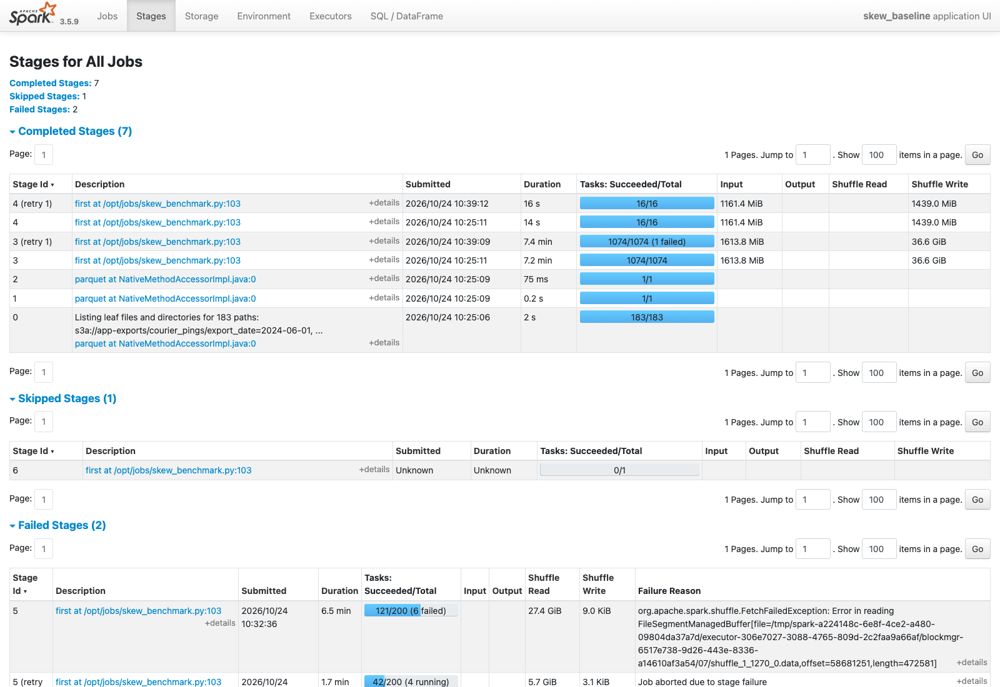
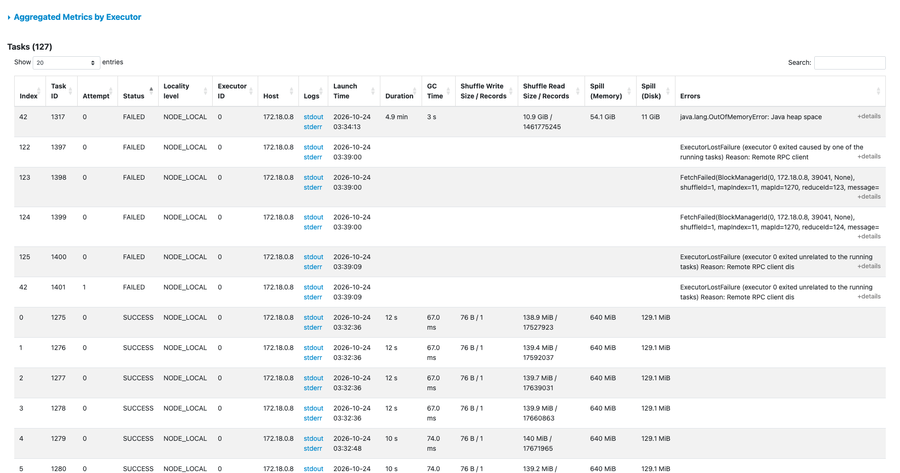
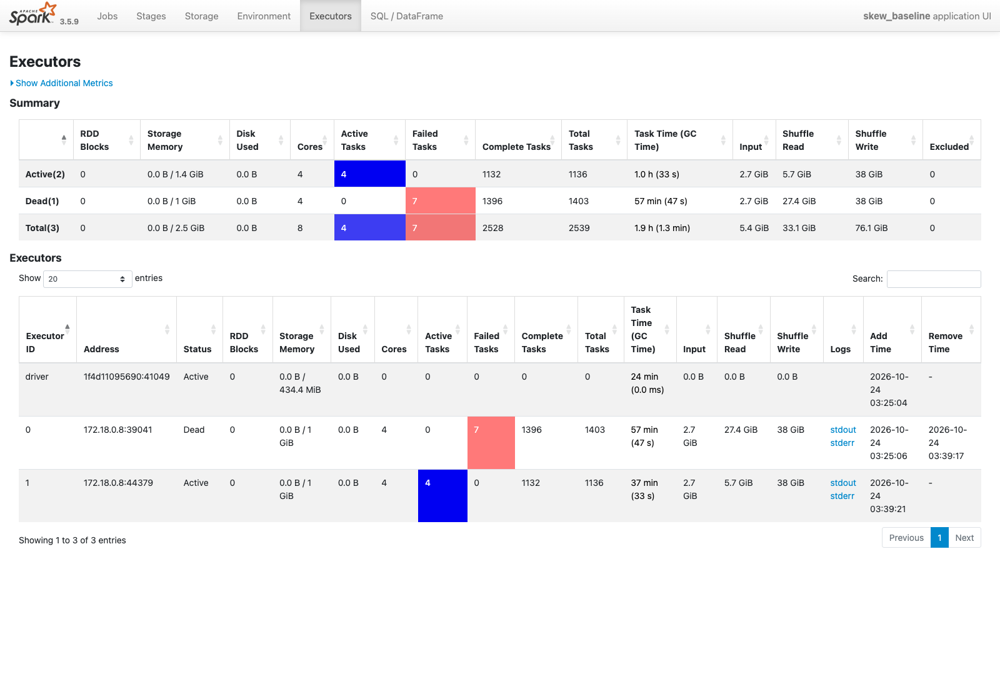
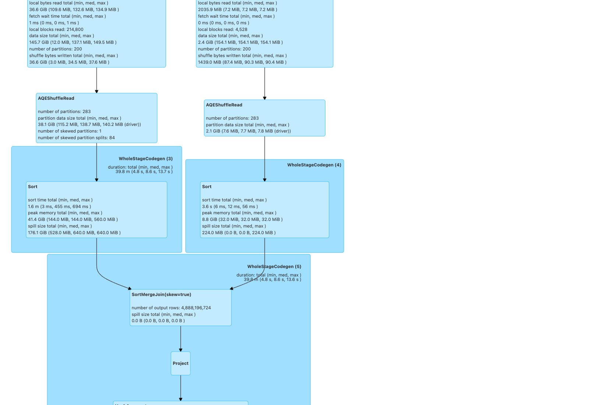
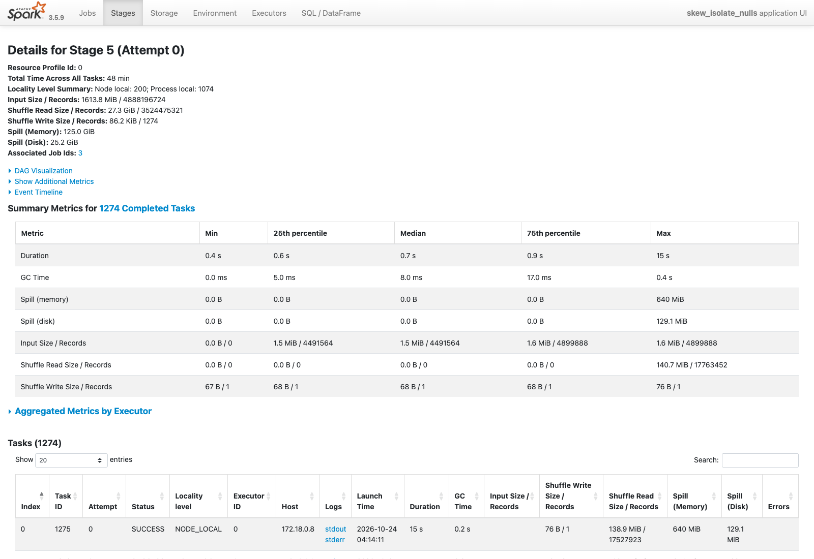
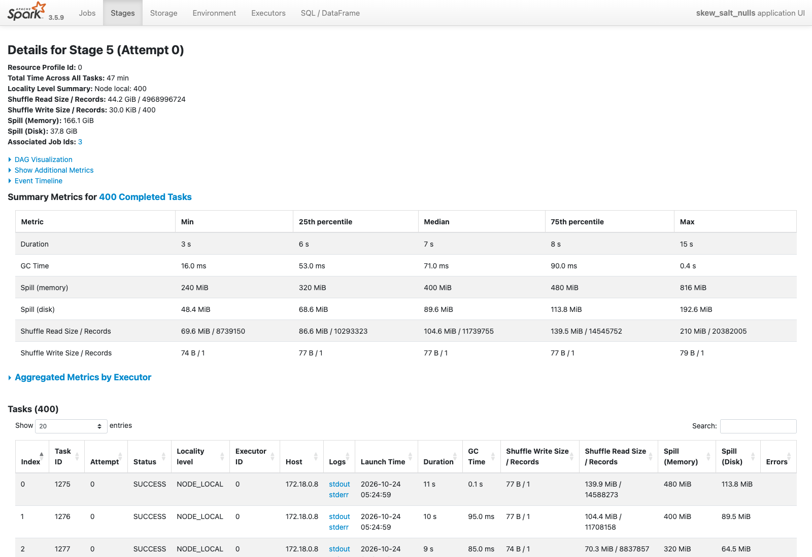
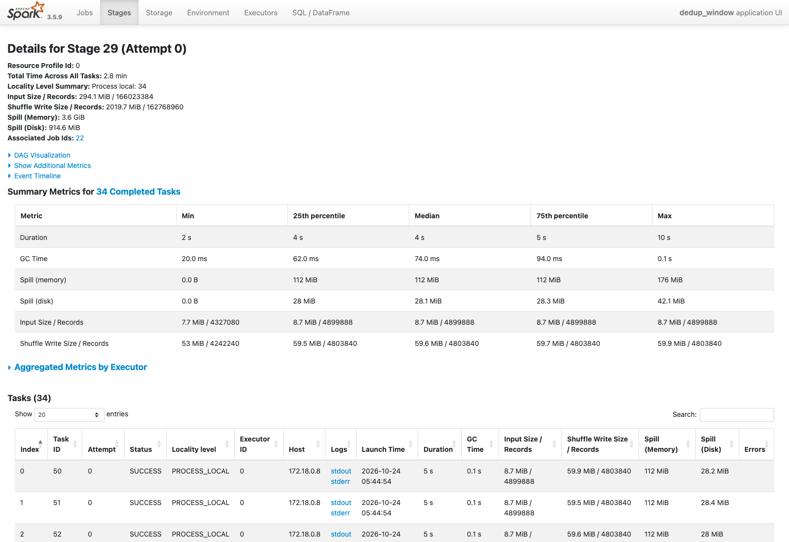
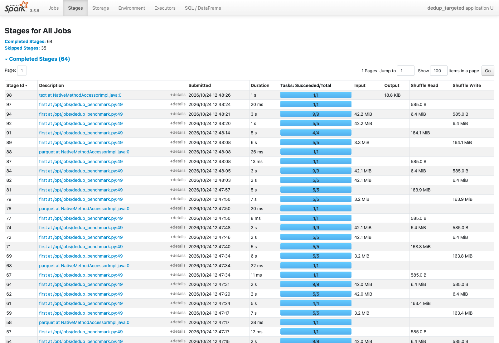

# Spark optimization at 100 GB

Each section has five parts:

- the problem in the generated data;
- what the Spark UI shows about it (the skew join and the duplicates; the schema problem shows in
  the data, as missing columns, and not in the UI);
- the methods tried;
- the measured results;
- how the chosen method runs in the Airflow pipelines.

The data is the full-scale generation of 2026-10-24: 4.89 billion pings in 88.82 GB of Parquet,
and 80.8 million orders ([data_characteristics.md](data_characteristics.md)).

**The cluster.** Spark 3.5.9 standalone, with one worker of 4 cores and one executor of 2 GB
(`spark.executor.memory 2g`). There are 200 shuffle partitions. The runs are one at a time, on an
otherwise idle cluster, with `scripts/disk-watch.sh` running beside them
([environment.md](environment.md#disk-safety-for-the-100-gb-runs)).

**How the runs are measured.** Each job reads its own stages back from the Spark UI's REST API
(`stage_metrics` in `jobs/common.py`). It records them with the wall time and the result in
`s3a://lakehouse/_benchmarks/`:

- the tasks of each stage;
- input, shuffle and spill bytes;
- the median and the slowest task, both run time and shuffle read.

The screenshots come from the Spark history server (`http://127.0.0.1:18080`).

## Skew: pings LEFT JOIN their trip on `trip_id` (`jobs/skew_benchmark.py`)

**The problem.** A ping on a trip carries the trip's `order_id` in `trip_id`. The 29.55% of pings
sent between trips carry NULL. Joining pings to their order, for example to know whether the trip
ended late, is a LEFT JOIN on `trip_id`.

A sort-merge join hash-partitions both sides by the key, and every NULL hashes to the same
partition. So one task of the 200 gets 29.55% of the pings, while the others share the rest. A
NULL never matches an order, so all that work only produces rows with NULL order columns.

**Four methods.** They all compute the same checksum over the join result: rows, matched rows,
pings on late trips, and a hash sum. The runs must agree on it. Broadcast joins are off in all of
them: the order side has 80.8 million rows, too large to broadcast, and the comparison is about
the shuffle.

| Method | What it does |
|---|---|
| `baseline` | AQE off: a plain sort-merge join |
| `aqe` | AQE on with its skew-join rule (`spark.sql.adaptive.skewJoin.enabled`). Spark 3.5 can split an oversized partition of the left side of a LEFT OUTER join into tasks of the advisory size |
| `isolate_nulls` | AQE off. The NULL pings skip the join and are added back with NULL order columns |
| `salt_nulls` | AQE off. In the join key, a NULL `trip_id` becomes a random negative number from −1 to −1,000, which no order matches, so the NULL rows spread over 1,000 keys. It uses 400 shuffle partitions; the first versions used 64 salts and 200 partitions (see the results) |

```python
# jobs/skew_benchmark.py
if method == "isolate_nulls":
    matched = pings.where(F.col("trip_id").isNotNull()).join(trips, pings.trip_id == trips.order_id, "left")
    idle = pings.where(F.col("trip_id").isNull()).select(
        *pings.columns, *[F.lit(None).cast(f.dataType).alias(f.name) for f in trips.schema.fields]
    )
    return matched.unionByName(idle)
if method == "salt_nulls":
    spread = F.coalesce(F.col("trip_id"), -(F.floor(F.rand(7) * SALTS).cast("long") + 1))
    salted = pings.withColumn("join_key", spread)
    return salted.join(trips, salted.join_key == trips.order_id, "left").drop("join_key")
return pings.join(trips, pings.trip_id == trips.order_id, "left")      # baseline and aqe
```

**Salting must be in the key itself.** The first salting version put a salt column on both
sides: a random 1 to 64 on NULL pings, 0 on matched pings, and a literal 0 on every order. On 14
days, its slowest join task read 1,177 MB, more than the baseline's 807 MB. Spark's optimizer had
folded the literal: `salt = 0` became a filter after the join instead of a join key. The shuffle
was then partitioned by `trip_id` alone, so every NULL went to one partition again. The fixed
version salts only the key of the NULL rows, and the order side keeps a single key.

### What the Spark UI shows: the baseline at 100 GB

The full baseline wrote 36.6 GiB of ping shuffle in its map stage (7.2 minutes). The join stage
then ran 121 of its 200 tasks, each reading about 146 MB of shuffle.

Task 42 holds every NULL `trip_id`. It ran out of heap: `java.lang.OutOfMemoryError: Java heap
space`, and the executor exited with code 52, Spark's out-of-memory code. Spark lost that
executor's shuffle files (`FetchFailedException`), recomputed the map stages and started the join
stage again. It would have met the same partition with the same memory, so I stopped the run
after 23.6 minutes (1,413 s), during the second attempt.



The join stage's task table, sorted by status, shows the skew directly. Task 42 ran for 4.9 minutes,
read 10.9 GiB and 1,461,775,245 records of shuffle, and spilled 54.1 GiB in memory and 11 GiB to
disk before `java.lang.OutOfMemoryError: Java heap space`. Every task that finished read about
139 MiB and 17.6 million records in 10 to 12 s. The other failed tasks are the consequence: when
executor 0 exited, the tasks it was running failed with `ExecutorLostFailure`, and the tasks that
needed its shuffle files with `FetchFailed`.






### Results on 14 days (333,702,084 pings)

The first sweep ran each method on the first 14 export dates. All four gave the same checksum:
333,702,084 rows, 235,001,096 matched, 40,402,553 pings on late trips.

| Method | Wall time | Join tasks | Task time, median / slowest | Shuffle read per task, median / largest | Spill, memory / disk |
|---|---:|---:|---:|---:|---:|
| baseline | 79.1 s | 200 | 0.3 s / 29.1 s | 17.0 MB / 807.2 MB | 3.81 / 0.78 GB |
| aqe | 88.7 s | 81 | 1.5 s / 3.6 s | 51.1 MB / 66.5 MB | 16.07 / 2.50 GB |
| isolate_nulls | 81.1 s | 269 | 0.4 s / 1.7 s | 17.0 MB / 17.3 MB | 0 / 0 |
| salt_nulls (64 salts) | 76.5 s | 200 | 0.3 s / 2.1 s | 17.1 MB / 64.4 MB | 5.49 / 1.17 GB |

At this size the skew is visible but cheap. The NULL task reads 807 MB, 47 times the median, yet
it finishes in 29 s, so every method takes about the same time. AQE coalesces the 200 partitions
into 81, and its extra planning makes it the slowest here.

### Results on 100 GB (4,888,196,724 pings)

| Method | Result | Wall time | Join tasks | Task time, median / slowest | Shuffle read per task, median / largest | Ping shuffle written | Spill, memory / disk |
|---|---|---:|---:|---:|---:|---:|---:|
| baseline | **out of memory** on the NULL task; stopped | (23.6 min, not finished) | 200 | | 146 MB / (the NULL task failed) | 39.3 GB (36.6 GiB, the same map stage as AQE) | |
| aqe | finished | **1,079.6 s (18.0 min)** | 283 | 8.6 s / 14.2 s | 146.5 MB / 148.9 MB | 39.3 GB | 189.3 / 38.1 GB |
| isolate_nulls | finished | **1,148.2 s (19.1 min)** | 200 (+1,074 for the NULL rows) | 0.7 s / 14.8 s | — / 147.5 MB | **27.8 GB** | **134.2 / 27.1 GB** |
| salt_nulls, 64 salts | **out of memory** (tasks 21 and 149); stopped | (24.8 min, not finished) | 200 | | | | |
| salt_nulls, 1,000 salts | **out of memory** (task 6); stopped | (21.7 min, not finished) | 200 | | | 46.1 GB | |
| salt_nulls, 1,000 salts and 400 shuffle partitions | finished | 1,393.1 s (23.2 min) | 400 | 6.9 s / 14.8 s | 109.7 MB / 220.2 MB | 46.0 GB | 178.3 / 40.6 GB in the join, plus 182.7 / 43.6 GB in the map stage |

The three methods that finished gave the same checksum: 4,888,196,724 rows, 3,443,675,321 matched
(70.45%), 600,044,168 pings on late trips.

- **AQE** found 1 skewed partition and split it into 84 tasks of the advisory size. That is why
  the join stage has 283 tasks, and the largest reads 148.9 MB instead of the whole NULL
  partition. The plan marks the join `SortMergeJoin(skew=true)`. The split has a cost: each of the
  84 splits reads the matching order partition again, so the order side was read as 114,323,202
  records for 80,800,000 orders.
- **NULL isolation** keeps the NULL rows out of the shuffle: 27.8 GB of ping shuffle instead of
  39.3 GB (−29%), and 29% less spill. It reads the pings twice, once for each side of the union,
  so on this cluster it ends 69 s behind AQE.
- **Salting with 64 salts** was enough on 14 days, where each salt held 1.5 million NULL rows. At
  100 GB each held 22.5 million. A partition that drew one or two salts then held 40 to 60
  million rows, and its sort ran out of memory. With **1,000 salts** the NULL rows spread evenly,
  but into every one of the 200 partitions. Each partition then held 24 million rows, 40% more
  than in the baseline, and the extra 8-byte key added 7 GB of shuffle. The sorts failed again.
  Salting moves the skewed rows into the shuffle instead of removing them, so it needs more
  partitions as the data grows. With **400 partitions** it finished, in 23.2 minutes and with the
  same checksum. It was the slowest of the three that finished. Above 200 partitions the shuffle
  writer sorts and spills on the map side too, which added 43.6 GB of disk spill there.








### The choice for the pipeline

DP2 keeps **NULL isolation**, with AQE also on (`spark.sql.adaptive.enabled` is on by default in
Spark 3.5, and the platform does not turn it off).

- **DP2 runs one day at a time.** One full-scale day has a NULL partition of about 64 MB of
  shuffle: the one-day trial measured a largest task of 64 MB against a median of 8 MB (see the
  trials below). AQE only
  splits a partition larger than 256 MB and 5 times the median
  (`spark.sql.adaptive.skewJoin.skewedPartitionThresholdInBytes`, `skewedPartitionFactor`), so
  its rule would not apply to a daily batch. NULL isolation removes the NULL rows from the shuffle
  at any size.
- **It also writes 29% less shuffle and spills 29% less.** That matters on a laptop whose disk
  holds the data too.
- **AQE stays on** for the joins NULL isolation does not cover. It is the simplest fix when a
  whole history is rebuilt at once: at 100 GB it finished first, with no code change.

**The one-day trials (2026-10-24).** Before the sweeps, each method ran on one full-scale export
date. All four matched 16,639,434 pings, so the four joins agree. Their times are not a fair
comparison: the trials ran from 02:27 to 02:48 PT, while the generator was still writing the
last export dates to the same disk.

| Method | Wall time, one day |
|---|---:|
| baseline | 321.6 s |
| aqe | 395.2 s |
| isolate_nulls | 294.3 s |
| salt_nulls (64 salts) | 164.2 s |

Most of each trial is the order side: every method shuffles all 80.8 million orders, whatever the
number of ping days. That is why one day of NULL isolation took 294 s, about a quarter of its
1,148 s for 183 days.

**Integration into Airflow.** `jobs/dp2_gold_facts.py` joins the silver pings to `fact_delivery`
on `trip_id`, to count the minutes on trips that ended late (`late_trip_min` in
`fact_courier_activity_hourly`). The idle pings skip that join:

```python
# jobs/dp2_gold_facts.py, build_fact_activity
trips = spark.table("gold.fact_delivery").select(F.col("order_id").alias("trip_id"), "is_late")
idle = F.col("trip_id").isNull()
pings = pings.where(~idle).join(trips, "trip_id", "left").unionByName(
    pings.where(idle).withColumn("is_late", F.lit(None).cast("boolean"))
)
```

This runs in the `gold_facts` task of the `dp2_transform_validate` DAG
([airflow.md](airflow.md)), and the DP2 suite checks the new column (`late_trip_min` between 0 and
60).

**Checked on the dev slice (2026-10-24).** `dp2_gold_facts.py --rebuild` rewrote both facts in
2.5 minutes, with the new column:

- 335,990 activity rows, as before;
- `late_trip_min` sums to 2,476,940 minutes, which is 12.29% of all ping minutes. That fits the 70%
  of pings that are on a trip, times the 17.6% of deliveries that are late (12.4%).

The DP2 suite then passed 62 of 62 expectations for 2024-11-27, the new one included.

**In Airflow (2026-10-24).** The `dp2_transform_validate` run for 2024-11-29 was green in 266 s.
`gold_facts` took 41.9 s, the suite passed 62 of 62, and `publish_assertions` sent the new check to
DataHub with the others. The run is described in [airflow.md](airflow.md#run-after-the-100-gb-work-2026-10-24).

That run had no new ping date, because DP1 did not run before it. So `gold_facts` merged no new
activity hours, and the NULL-isolation join above did not execute in it; nor did the per-date
`OPTIMIZE` of silver ([storage_optimization.md](storage_optimization.md)). Both ran in the manual
rebuilds of 2026-10-24: `dp2_gold_facts.py --rebuild` above, and a `dp2_silver.py` rebuild that
went through the new compaction step. The run
proves the DAG, the suite with the new `late_trip_min` check, and the DataHub publication. In a
daily run that brings a new ping date, the same task code runs the join and the compaction.

## Schema evolution: app v2 pings next to v1 (`jobs/schema_evolution_demo.py`)

**The problem.** From 2024-09-01 the courier app v2 rolls out over 14 days. v2 replaces
`speed_kmh` (int) with `speed_mps` (float) and adds `battery_pct` and `gps_accuracy_m`, in new
files in the same `export_date` folders as v1. A reader that assumes one schema either loses
columns or fails ([data_characteristics.md](data_characteristics.md#schema-before-and-after-the-app-v2-change)).

**The demo** reads three full-scale export dates: 2024-08-31 (v1 only), 2024-09-07 (both) and
2024-09-15 (v2 only). It runs three steps:

1. A read without `mergeSchema`, which takes one file's schema.
2. A Delta table created from v1, then an append of v2 rows without `mergeSchema`.
3. A read with `mergeSchema`, the Delta append with `mergeSchema`, and one speed column.

**Results (2026-10-24, 80,959,776 pings, 55 s):**

```text
[1 naive read] 10 columns; lost against the merged read: ['battery_pct', 'gps_accuracy_m', 'speed_mps']
[1 naive read] rows per app version: {'4.0.0': 40716612, '3.14.2': 40243164}
[1 naive read] pings without speed_kmh: 40,716,612 of 80,959,776
[2 append without mergeSchema] refused: [_LEGACY_ERROR_TEMP_DELTA_0007] A schema mismatch detected when writing to the Delta table
[3 merged read] 13 columns; rows per app version: {'4.0.0': 40716612, '3.14.2': 40243164}
[3 append with mergeSchema] table columns: [..., 'speed_kmh', 'app_version', 'uploaded_ts', 'speed_mps', 'battery_pct', 'gps_accuracy_m']
[3 history] version 0: WRITE {'mode': 'Overwrite', 'partitionBy': '[]'}
[3 history] version 1: WRITE {'mode': 'Append', 'partitionBy': '[]'}
[3 unified speed] pings without a speed: 0 of 80,959,776; v2 columns present: ['battery_pct', 'gps_accuracy_m', 'speed_mps']
```

1. **The naive read fails silently.** Spark takes the schema from one file. Here that was a v1
   file, so the read had 10 columns. Every v2 ping, 50.3% of the rows, then had no speed, and no
   error was raised. It could as well have taken a v2 file and lost `speed_kmh` for the v1 rows.
2. **Delta refuses the change.** A v1 table rejects an append of v2 rows unless the writer allows
   the new columns. A pipeline that does not plan for the new version stops there.
3. **The merged read and `mergeSchema` work.** The merged read has all 13 columns: a v1 row has
   NULL in the v2 columns and the other way round. The append with `mergeSchema` adds the three new
   columns to the table, recorded as version 1 in its history. `coalesce(speed_kmh, speed_mps × 3.6)`
   leaves no ping without a speed.

**In the pipelines.** Step 3 is what DP1 and DP2 do:

- DP1 reads every export date with `mergeSchema` and appends to `bronze.raw_courier_pings` with
  `mergeSchema` ([pipelines.md](pipelines.md#dp1-ingest-into-bronze-jobsdp1_ingestpy)).
- DP2 unifies the two speeds in `silver.stg_courier_pings` and keeps `schema_version`.
- The DP2 suite checks it on every run: no NULL `speed_kmh` or `schema_version`, and
  `schema_version` in {1, 2}.

On the slice, 2024-09-07 (a rollout day) passed with both versions present
([pipelines.md](pipelines.md#checks-on-the-dev-slice-2024-09-07-a-v2-rollout-day)).

## Duplicates: the 2% re-uploaded pings (`jobs/dedup_benchmark.py`)

**The problem.** The app re-uploads whole 5-minute batches. The copies repeat `(courier_id,
device_seq)` with a later `uploaded_ts`, in the same `export_date` folder. That is 95,819,124
extra rows at full scale, 1.999% of the originals. Silver keeps the earliest upload of each key.

**Two methods** keep the same rows. Both read whole rows, as silver does, and a checksum over the
kept rows must agree:

| Method | What it does |
|---|---|
| `window` | silver's way: `row_number()` over `(courier_id, device_seq)` ordered by `uploaded_ts`, which shuffles and sorts every column of every row |
| `targeted` | one `export_date` at a time. It finds the duplicated keys from the two key columns only. Every other row passes through a broadcast anti-join, with no shuffle of the wide rows, and only the rows of the duplicated keys go through the window |

```python
# jobs/dedup_benchmark.py
def targeted(day):
    duplicated = day.groupBy(*KEY).count().where(F.col("count") > 1).select(*KEY)
    keys = F.broadcast(duplicated)
    return day.join(keys, KEY, "left_anti").unionByName(earliest_upload(day.join(keys, KEY, "left_semi")))
```

**Results (2026-10-24), on the first 7 full-scale export dates.** Each method is shown with its
time and the shuffle and spill summed over its stages.

| Method | Rows in | Rows kept | Removed | Wall time | Shuffle written | Spill, memory / disk |
|---|---:|---:|---:|---:|---:|---:|
| window | 166,023,384 | 162,768,960 | 3,254,424 (1.9994% of kept) | **73.3 s** | 2.12 GB | 7.58 / 2.06 GB |
| targeted | 166,023,384 | 162,768,960 | 3,254,424 (1.9994% of kept) | 120.2 s | **1.28 GB** | 29.09 / 1.71 GB |

- **The rows removed match the injection.** The generator re-uploads 2.00% of the rows, and
  both methods remove 1.9994% of the rows they keep.
- **The two methods agree.** They keep the same rows, with the same checksum
  (−6,968,598,871,620,969,569).
- **The targeted method writes 40% less shuffle**, as planned, because only the two key columns
  and the 4% of rows with a duplicated key are shuffled.
- **But it is 64% slower here.** Each day is read three times, for the key count, the anti-join
  and the semi-join. The seven days also run one after another, and every day's job is too small
  to keep the 4 cores busy.

**What the Spark UI shows.** The window method has one big shuffle: stage 29 reads the 7 days
(166,023,384 rows, 294.1 MiB of Parquet) in 34 tasks and writes 2,019.7 MiB of shuffle for the
`row_number()` window, spilling 3.6 GiB in memory and 914.6 MiB to disk. Its tasks are even, 4 s
at the median and 10 s at most, so there is no skew to fix here, only the volume.



The targeted method has many small stages instead: for each day, one stage reads the two key
columns (3.2 MiB) and shuffles the key counts, and two more read the whole day again (42 MiB each)
for the anti-join and the semi-join. Each stage has 4 to 9 tasks and lasts 1 to 7 s, so the
4 cores wait between stages. That is where most of its extra 47 s goes.



A ping has 10 to 12 narrow columns, so shuffling whole rows costs less than reading the files
from SeaweedFS again.

**The choice for the pipeline.** Silver keeps the window method
(`jobs/dp2_silver.py`, `row_number()` over `(courier_id, device_seq)` by `uploaded_ts`). The
targeted method would win for wide rows, where the shuffle grows with the row width while the key
count does not. It would also win when a lookup of known duplicate keys is already available, and
the pings have neither.

The DP2 suite checks the result on every run: `(courier_id, device_seq)` is unique in
`stg_courier_pings`. On the slice, 967,704 duplicates were removed, exactly the injected count
([pipelines.md](pipelines.md#checks-on-the-dev-slice-2026-10-23-1)).
