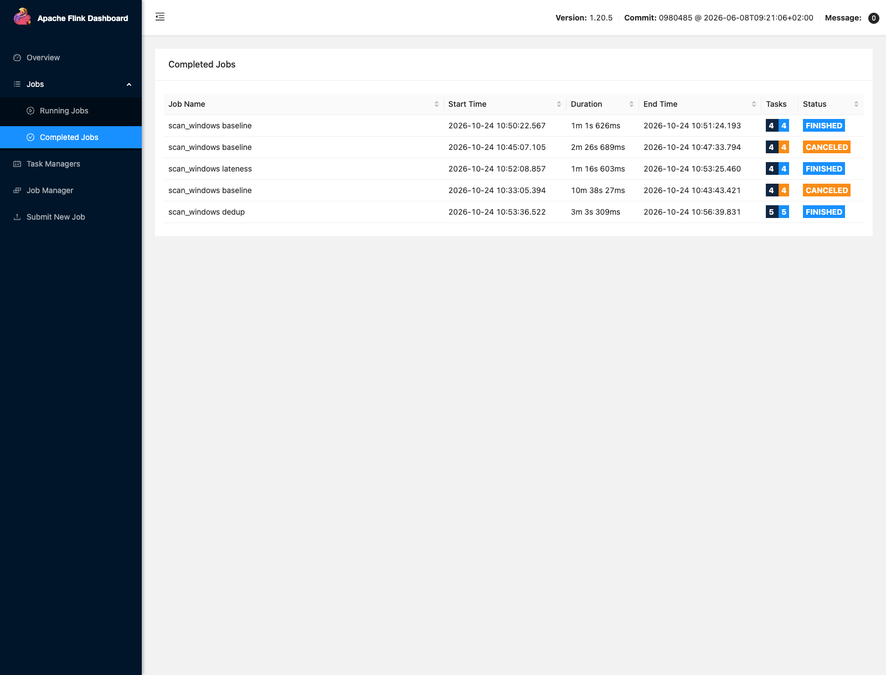
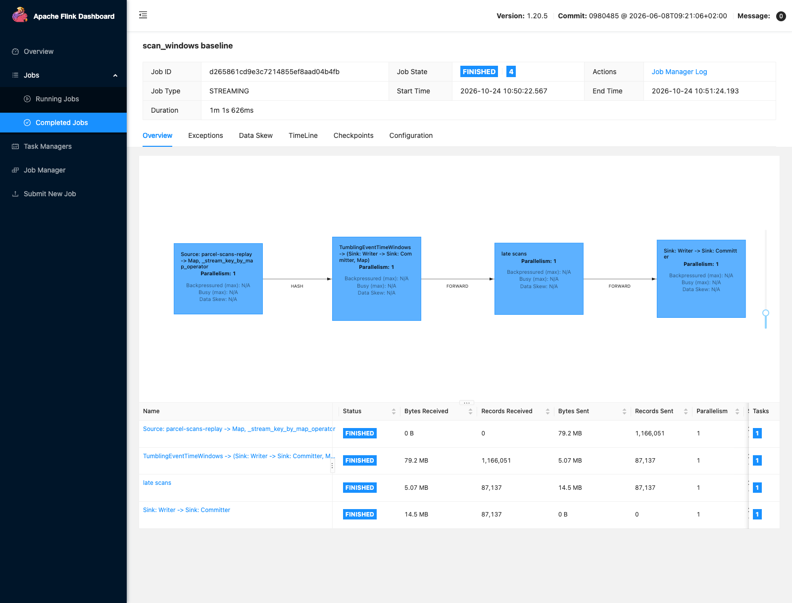
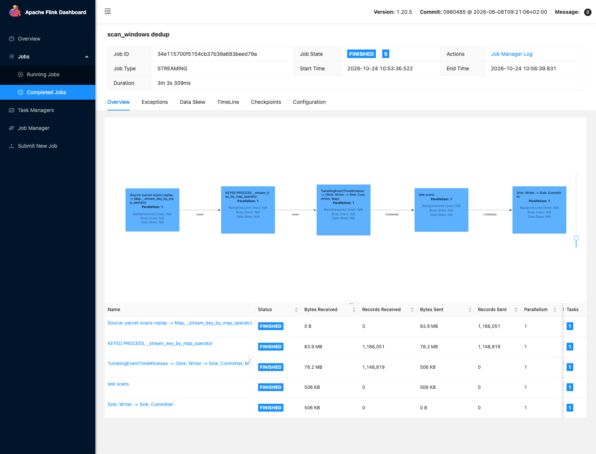

# Streaming: live parcel-scan events in Kafka

The handhelds at the hubs and in the vans send every parcel scan to Kafka as it happens. The stream
has two problems on purpose:

- **late arrivals:** weak signal holds some scans back for minutes;
- **duplicates:** a handheld that gets no acknowledgement sends the same scan again.

Flink counts the scans in 5-minute windows per hub. Each run is checked window by window against
the truth recomputed from the export Parquet.

| Mode | What the job does | Earns |
|---|---|---|
| `baseline` | windows close at the watermark; late scans go to a side output | E16 |
| `lateness` | windows keep their scans 20 minutes past the watermark; each late scan fires the window again | E17 |
| `dedup` | `lateness`, plus a keyed dedup on `scan_id` with a state TTL before the windows | E18 |

## Topics

The topics are created by `kafka-init` ([core_services.md](core_services.md)).

| Topic | Partitions | Written by | Holds |
|---|---:|---|---|
| `parcel-scans` | 3 | `generator/scan_producer.py` | the live stream, keyed by `order_id`, so the scans of one parcel stay in order on one partition |
| `parcel-scans-replay` | 1 | `generator/scan_producer.py` | the same events on one partition, for the Flink runs (see below) |
| `hub-delivery-5m` | 3 | Flink | delivered and late-delivered scans per hub and 5-minute window |
| `scans-late` | 1 | Flink | the side output: scans that arrived after their window closed |

**Why a 1-partition replay topic.** A Flink source's watermark is the minimum over its
partitions, so a partition that lags or sits idle holds every window open. With one partition,
the watermark follows the arrival order exactly, and a run is repeatable.

## The event

One JSON record per scan send. The key is `order_id`. The **Kafka record timestamp is
`scan_ts`**, the event time (`CreateTime`), so Flink can take event time from the record.

| Field | Type | Meaning |
|---|---|---|
| `scan_id` | bigint | the scan; a retry carries the same id |
| `order_id` | bigint | the parcel's order |
| `hub_id` | int | the hub of the order |
| `courier_id` | int or null | the courier; null for the `at_hub` scan by hub staff |
| `scan_type` | string | `at_hub`, `picked_up` or `delivered` |
| `scan_ts` | epoch ms (UTC) | when the scan happened (event time) |
| `promised_ts` | epoch ms (UTC) | the promised delivery time, so a `delivered` scan can be counted as late-delivered |
| `sent_ts` | epoch ms (UTC) | when the handheld sent it (arrival) |

## How the producer builds the events

```bash
uv run python -m generator.scan_producer --start 2024-11-04 --days 7 --topic parcel-scans-replay
uv run python -m generator.check_stream  --start 2024-11-04 --days 7 --topic parcel-scans-replay
```

1. **Read the scans** of export dates `--start` to `--start + days - 1` from
   `s3://app-exports/parcel_scans/` (each date must have its `_SUCCESS` marker). The same Parquet
   files are the truth that the Flink windows are checked against.
2. **Read each order's `promised_ts` and drop `area`** from `oms.orders` (the area trimmed).
3. **Delay every scan.** A scan is sent 0 to 3 s after it happens. Exactly 8% of the scans arrive
   2 to 20 minutes late instead (uniform). The late ones are chosen per area:
   - 25% of the scans of Semi-Urban and Other drops, where the signal is weak;
   - in Metropolitan and Urban, the share that makes 8% overall (6.1% for the default week).
4. **Retry 1.50% of the scans.** Each is sent a second time, 1 to 10 s after its first send,
   with the same payload.
5. **Send in arrival order** (`sent_ts`), keyed by `order_id`, with `timestamp=scan_ts`. The
   producer is idempotent (`enable.idempotence`), so Kafka's own retries add no duplicates. Only
   the 1.50% are duplicates.

The counts are exact (`round(share × scans)` rows drawn without replacement), and one seed fixes
every choice, so a rerun sends the same events.

- **Replacing the events.** Before sending, the producer empties the topic: `delete_records` up
  to the end offsets, which keep counting. `--keep` appends instead.
- **Pacing.** `--rate N` limits the send to N events per second. Without it, the week goes out
  in under a second. Event time comes from the records, so the send speed does not change any
  window.

The default slice is the week of 2024-11-04 to 2024-11-10. It is outside both peak weeks, so its
volume is ordinary: 83,460 scans, from the 28,000 orders of that week plus the ones that span its
midnights. 9.9% of the week's orders drop in Semi-Urban or Other.

## Measured (2026-10-24)

`check_stream` reads every record back from the topic and compares each rate with its target.
It passed 11 of 11 on `parcel-scans-replay`, and again on `parcel-scans` (3 partitions):

| Check | Measured | Target |
|---|---:|---|
| record timestamp is `scan_ts` | 100% | 100% |
| record timestamps of type `CreateTime` | 100% | 100% |
| late scans (2 to 20 min) | 8.000% | 8.00% ± 0.05 |
| late scans in Semi-Urban and Other | 25.006% | 25.00% ± 0.05 |
| late delays outside 2 to 20 min | 0 | 0 |
| on-time delays outside 0 to 3 s | 0 | 0 |
| scans sent twice | 1.500% | 1.50% ± 0.05 |
| scans sent more than twice | 0 | 0 |
| retry gaps outside 1 to 10 s | 0 | 0 |
| retries with a different payload | 0 | 0 |
| scans missing or extra against the export | 0 | 0 |

**Facts:**

- **Records:** 84,712: 83,460 distinct scans and 1,252 retries. Event time runs from 2024-11-04
  08:00 UTC (00:00 in LA) to 2024-11-11 07:59 UTC.
- **Late share by area:** Metropolitan 6.00%, Urban 6.34%, Semi-Urban 25.14%, Other 24.70%.
- **Late delays, in minutes:** 1,086 scans at 2 to 5, 1,894 at 5 to 10, 1,851 at 10 to 15, and
  1,846 at 15 to 20. That is uniform; the first bucket is 3 minutes wide.
- **On-time delay:** median 1.5 s, p99 2.97 s, maximum 3.00 s. **Retry gap:** 1.01 to 9.99 s.
- **Out of order:** 14.16% of the records arrive behind the newest event time already seen.
  7.99% arrive more than 10 s behind it, which is the bound of the Flink baseline's watermark.
  On `parcel-scans`, with the order taken within each of its 3 partitions, they are 10.29% and
  7.97%.
- **Speed:** 84,712 events in 0.6 s as fast as possible, and 16.9 s at `--rate 5000`.

`tests/test_scan_producer.py` checks the same rules on synthetic scans, without Kafka: the exact
shares, the delay ranges, the retries, arrival order, the same events from the same seed, and a
missing order refused. It also checks that every `check_stream` check passes on the built events.

## Flink: the session cluster (profile `stream`)

```bash
docker compose --profile core --profile stream up -d --wait
```

| Service | Image | Settings | Port on the Mac | Idle memory |
|---|---|---|---|---:|
| `flink-jobmanager` | `lastleg/flink:1.20.5` (multi-stage) | `jobmanager.memory.process.size: 1024m` | `127.0.0.1:8084` (Flink UI; 8081 is the Spark worker UI) | 338 MiB |
| `flink-taskmanager` | same | `taskmanager.memory.process.size: 2048m`, 1 slot, parallelism 1 | | 427 MiB |

The idle memory was measured on the first image, `lastleg/flink:1.20.5-naive`, which also ran the
slice-week results below.

The image adds these to `flink:1.20.5-scala_2.12-java17`. The first build
(`infra/flink/Dockerfile.naive`) was 2.06 GB; the services now run the multi-stage
`infra/flink/Dockerfile` at 1.68 GB ([environment.md](environment.md#built-images-naive-against-multi-stage)):

- Python 3.10.12 and PyFlink 1.20.5, compiled from source because PyPI has no arm64 wheel
  ([environment.md](environment.md#pyflink-on-arm64)). The compilers are only in the first stage,
  which builds the wheels; the image the services run keeps none.
- `libpython3.10`, which thread mode needs.
- `flink-sql-connector-kafka` 3.4.0-1.20.
- A copy of `flink-python` in `lib/` (see Pitfalls).

The jobs in `flink/jobs/` are mounted at `/opt/flink/jobs` and submitted from the jobmanager. They
reach Kafka at `kafka:19092`.

## The window job (`flink/jobs/scan_windows.py`)

```python
watermarks = WatermarkStrategy.for_bounded_out_of_orderness(OUT_OF_ORDERNESS)            # 1
scans = env.from_source(source, watermarks, SOURCE).map(parse, output_type=scan_type())  # 2
if args.mode == "dedup":                                                                 # 2b
    scans = scans.key_by(lambda scan: scan[SCAN_ID], key_type=Types.LONG()).process(FirstSend(), output_type=scan_type())

late = OutputTag("late-scans", scan_type())
counts = (
    scans.key_by(lambda scan: scan[HUB_ID], key_type=Types.INT())                         # 3
    .window(TumblingEventTimeWindows.of(WINDOW))                                         # 4
    .allowed_lateness(ALLOWED_LATENESS_MS[args.mode])                                    # 5
    .side_output_late_data(late)                                                         # 5
    .process(CountScans(args.mode), output_type=Types.STRING())                          # 6
)
counts.sink_to(kafka_sink(OUTPUT))                                                       # 7
late_scans = counts.get_side_output(late).map(as_json, output_type=Types.STRING()).name("late scans").disable_chaining()
late_scans.sink_to(kafka_sink(LATE))                                                     # 8
```

1. **The watermark trails the newest event time seen by 10 s.** A watermark W tells every operator
   that no scan older than W is expected any more. Flink emits it every millisecond
   (`set_auto_watermark_interval(1)`). No timestamp assigner is set: the Kafka source gives each
   record its record timestamp, which the producer set to `scan_ts`.
2. **The source** reads `parcel-scans-replay` from its first offset up to `--stop-offset`, and
   then ends. `parse` turns each JSON record into a tuple. Python runs in thread mode, inside the
   TaskManager's JVM.
   - **2b. Dedup** (`dedup` mode only). The stream is keyed by `scan_id`, so all sends of one scan
     reach the same `FirstSend` state. `FirstSend` keeps one flag per `scan_id` in keyed state: the
     first send sets it and passes on, and a retry finds it set and is dropped. The flag expires
     15 minutes after it was written (`StateTtlConfig`), so on a live stream the state holds only
     the last 15 minutes of scan ids instead of growing for ever. A retry trails its first send
     by 10 s at most, so it always finds the flag.
3. **`key_by` the hub:** each hub has its own windows.
4. **Tumbling event-time windows of 5 minutes:** a scan goes to the window `[k × 5 min,
   (k + 1) × 5 min)` that holds its `scan_ts`. Windows start on the epoch's 5-minute marks, which
   are also :00, :05, ... in Los Angeles.
5. **Allowed lateness, then the side output.** After a window fires, `allowed_lateness` keeps
   its scans for that long past the watermark: 0 in `baseline`, 20 minutes in `lateness`. A scan
   that arrives in that time is added, and the window fires again with the updated counts. A scan
   that arrives later than that goes to the side output instead of silently away. That is when
   the window's last millisecond, plus the allowed lateness, is at or behind the watermark.
6. **`CountScans` runs when the watermark passes the window's end.** It gets every scan of the
   window and counts three things: the scans, the `delivered` scans, and the `delivered` scans
   after `promised_ts`. Each firing is one JSON record, with the watermark at that moment.
7. **Two at-least-once Kafka sinks:** the windows go to `hub-delivery-5m`, the late scans to
   `scans-late`.
8. **The late scans are a task of their own** (`disable_chaining()`). Chained to the window, they
   were invisible in the Flink UI, which counts records only between tasks. As their own task,
   the UI shows how many scans missed their window. This changes no result, only what the UI can
   count; the slice-week results below ran before the change.

One window, and one late scan that missed a window:

```json
{"mode": "baseline", "hub_id": 39, "window_start": 1730707200000, "window_end": 1730707500000,
 "scans": 1, "delivered": 1, "late_delivered": 1, "watermark": 1730707885999}
{"scan_id": 1953063, "order_id": 651021, "hub_id": 1, "scan_type": "delivered",
 "scan_ts": 1730707241000, "promised_ts": 1730705496000, "sent_ts": 1730707958229}
```

The window is 2024-11-04 08:00 to 08:05 UTC, which is midnight in LA. The late scan happened at
08:00:41 and was sent at 08:12:38, almost 12 minutes later. By then the watermark had passed
08:05, so its window had already fired.

## How a run works (`generator/stream_windows.py`)

```bash
uv run python -m generator.stream_windows --mode baseline
```

1. Build the week's events exactly as `scan_producer` does: the same seed gives the same events.
2. Empty `parcel-scans-replay`, `hub-delivery-5m` and `scans-late`.
3. Submit the job, bounded at the offset after the last event, and wait until its tasks run.
4. **Send the events at 1,000 per second while the job reads them.**
5. Wait until the job finishes. At the stop offset the source ends, and the final watermark fires
   every window still open.
6. Rebuild the windows from the export Parquet, which is the truth, and compare them with the last
   firing of each output window.

**Why the replay is paced.** The week has 84,712 events over 7 days of event time: one every 7.1 s.
At 1,000 events/s, the 1 ms watermark interval is about one event, about 7 s of event time. That
is under the 10 s bound, so the watermark moves the way it would on a live stream.

A topic that is already full is read in about a second. The watermark would then jump hours of
event time between two emissions, so most late scans would still find their window open. That
would hide the very problem the baseline is meant to show.

**What is compared.**

- **Exact:** a window is exact when all three counts equal the truth.
- **Over- and under-counted:** a window is over-counted when a count is higher than the truth,
  and under-counted when one is lower. An output window that the truth does not have counts as
  over-counted. A truth window with no output counts as under-counted.
- **Conservation:** the scans in the windows plus the scans in `scans-late` must equal the records
  read. Every record either lands in a window or reaches the side output.
- **Simulated drops:** the drops a watermark updated after every record would cause, computed from
  the arrival order.

## Baseline results (2026-10-24)

Four runs of `--mode baseline`. Each job ran about 85 s, and conservation held in every run
(84,712 = scans in windows + dropped).

| Run | Windows exact (of 32,124) | Over-counted | Under-counted (missing) | Dropped (Flink) | Dropped (simulated) |
|---|---:|---:|---:|---:|---:|
| 1 | 26,650 = 82.96% | 911 | 4,577 (1,182) | 5,546 | 6,334 |
| 2 | 26,617 = 82.86% | 911 | 4,609 | 5,592 | 6,334 |
| 3 | 26,581 = 82.74% | 904 | 4,654 | 5,640 | 6,334 |
| 4 | 26,607 = 82.83% | 909 | 4,622 | 5,588 | 6,334 |

Runs 3 and 4 sent with `linger.ms=0` instead of 20. Producer batching made no difference.

Run 1 in totals:

| | Scans | Delivered | Late-delivered |
|---|---:|---:|---:|
| Truth | 83,460 | 27,577 | 4,738 |
| Flink | 79,166 | 26,281 | 4,525 |

The Flink total is 84,712 records read − 5,546 dropped = 79,166 scans in the windows.

**What the baseline shows:**

- **Late arrivals are lost to the windows.** Every dropped scan arrived at least 123 s after it
  happened: in run 4, 1,948 `at_hub`, 1,894 `picked_up` and 1,746 `delivered` scans. Run 1 has
  1,182 windows missing entirely: windows whose scans all came late.
- **Retries are counted twice.** The retries of on-time scans over-count 911 windows. A retry of
  a scan that came late is dropped with it: it arrives 1 to 10 s after the first send, and by then
  the watermark has not moved back.
- **Flink drops 11% to 12% fewer than the simulation,** and the count varies by up to 1.7%
  between runs. The source emits the watermark on a 1 ms timer, not after every record. So a late scan
  close to its window's end can still find the window open, depending on when the timer fired.

## Lateness results (2026-10-24)

`--mode lateness` passed both of its checks: 0 scans dropped, and 84,712 scans in the windows.

| | Baseline (run 1) | Lateness |
|---|---:|---:|
| windows exact (of 32,124) | 26,650 = 82.96% | 30,929 = 96.28% |
| over-counted | 911 | 1,195 |
| under-counted (missing) | 4,577 (1,182) | 0 (0) |
| dropped (Flink, simulated) | 5,546, 6,334 | 0, 0 |
| firings | 30,942 | 36,525 |
| scans, delivered, late-delivered | 79,166, 26,281, 4,525 | 84,712, 28,002, 4,825 |
| job runtime | 85.1 s | 88.0 s |

- **20 minutes is enough by construction.** A scan arrives at most 20 minutes after it happens.
  The newest event time seen at that moment is no later than the arrival, so the watermark is at
  least 10 s short of the scan's time plus 20 minutes. The scan's window, plus 20 minutes, is
  therefore still open. The simulation agrees: 0 drops.
- **Late firings.** 4,401 firings come after a window's first one. Each is a late scan that
  found its window already fired. A window whose scans all came late fires for the first time on
  its first late scan, so that firing is not an extra one: the baseline's 5,546 drops minus its
  1,182 missing windows is 4,364, close to 4,401. The check takes each window's last firing. A consumer of
  `hub-delivery-5m` must also treat a later record for the same hub and window as a replacement,
  not an addition.
- **What lateness costs.** Every window's state lives 20 minutes longer, and every late scan
  causes another output record.
- **Retries are still counted twice.** The 1,252 retries over-count 1,195 windows (some windows
  get two). That is now the only difference from the truth: 84,712 − 1,252 = 83,460 scans.

## Dedup results (2026-10-24)

`--mode dedup` passed its three checks: 100.00% of the windows exact, 0 scans dropped, and 83,460
scans in the windows, which equals the distinct scans read.

| | Baseline (run 1) | Lateness | Dedup |
|---|---:|---:|---:|
| windows exact (of 32,124) | 26,650 = 82.96% | 30,929 = 96.28% | **32,124 = 100.00%** |
| over-counted | 911 | 1,195 | 0 |
| under-counted (missing) | 4,577 (1,182) | 0 (0) | 0 (0) |
| dropped (Flink, simulated) | 5,546, 6,334 | 0, 0 | 0, 0 |
| firings | 30,942 | 36,525 | 36,369 |
| scans | 79,166 | 84,712 | 83,460 |
| delivered | 26,281 | 28,002 | 27,577 |
| late-delivered | 4,525 | 4,825 | 4,738 |
| job runtime | 85.1 s | 88.0 s | 88.0 s |

The truth is 83,460 scans, 27,577 delivered and 4,738 late-delivered, so the dedup run equals it
in every window.

The record counts per task in Flink's REST API (`/jobs/<id>`) show where the retries go:

| Task | Records in | Records out |
|---|---:|---:|
| `Source: parcel-scans-replay -> Map` | | 84,712 |
| `KEYED PROCESS` (`FirstSend`) | 84,712 | 83,460 |
| `TumblingEventTimeWindows -> sinks` | 83,460 | |

`FirstSend` removed exactly the 1,252 retries.

**State TTL is processing time.** Flink counts a flag's 15 minutes in wall-clock time. In a paced
replay, the whole week takes 85 s, so no flag expires during a run. On a live stream, wall-clock
time and event time move together. The TTL then bounds the state to about 15 minutes of scans,
against a retry gap of 10 s at most.

## Flink UI proof (2026-10-24): one full-scale day

The slice-week runs above ran before the late scans were their own task, so their Flink UI could
not show the drops. After that change (step 8), the three modes ran again on the multi-stage
image, `lastleg/flink:1.20.5`. By then `app-exports` and `oms` held the full-scale generation, so
the runs replay one full-scale day: the scans of export date 2024-11-04.

```bash
uv run python -m generator.stream_windows --mode baseline --start 2024-11-04 --days 1 --rate 20000
```

**The pacing rule still holds.** The day has 1,166,051 records over 86,400 s of event time,
about 13.5 per event-second. At 20,000 records per second, one 1 ms watermark interval covers
about 1.5 s of event time, well under the 10 s bound. The baseline job kept up with the sending
(61.6 s for 58.3 s). The dedup job read more slowly (183.3 s), so each interval covered even less
event time. The records are 1,148,819 scans and 17,232 retries (1.50%).

| | Baseline | Lateness | Dedup |
|---|---:|---:|---:|
| windows exact (of 9,281) | 1,112 = 11.98% | 3,811 = 41.06% | **9,281 = 100.00%** |
| over-counted, under-counted | 908, 7,728 | 5,470, 0 | 0, 0 |
| windows missing | 19 | 0 | 0 |
| dropped (Flink, simulated) | 87,137, 87,261 | 0, 0 | 0, 0 |
| scans in the windows (truth 1,148,819) | 1,078,914 | 1,166,051 | 1,148,819 |
| firings | 9,262 | 96,414 | 95,134 |
| job runtime | 61.6 s | 76.6 s | 183.3 s |

A full-scale window holds about 124 scans, against about 3 on the slice. Most windows therefore
hold at least one late scan or one retry, which is why fewer windows are exact than on the slice.
The three fixes give the same verdict: allowed lateness removes every drop, and the keyed dedup
then makes every window exact. The baseline's 87,137 drops are within 0.14% of the simulated
87,261, because at this rate the watermark moves almost record by record.

**What the Flink UI shows.** The job graph's table counts the records between tasks. The
`Records Sent` of the window task is the number of scans it sent to the side output, and the
`Records Received` of `late scans` is the same number.

The completed jobs. The two cancelled baseline jobs are the first attempts, which replayed a
whole full-scale week at 1,000 records per second, about 2 hours a run; they were stopped:



**Baseline.** The window task receives all 1,166,051 records and sends 87,137 to `late scans`:
every one of them arrived after the watermark had passed its window's end.



**Allowed lateness.** The same graph, with 20 minutes of allowed lateness. The window task sends
0 records to `late scans`: every late scan found its window still open.


**Dedup.** The `KEYED PROCESS` task (`FirstSend`) receives 1,166,051 records and sends 1,148,819:
it removed exactly the 17,232 retries. The window task then sends 0 records to `late scans`.



## Pitfalls

- **The slice must exist in the exports.** The producer stops if a date lacks `_SUCCESS`. After
  the full-scale generation, the same command sends 100 times as many events (about 1.2 million a
  day).
- **Without emptying, the topic holds every replay,** and a reader from the earliest offset would
  count each scan once per replay. That is why the producer empties the topic by default.
- **Kafka deleted the scans minutes after they were written.** The first Flink job read 0
  records: the topic's log start offset equalled its end. Time-based retention judges a segment
  by its record timestamps, and the 2024 event times are older than the 7-day default.
  `kafka-init` now sets `retention.ms=-1` on the four stream topics
  ([core_services.md](core_services.md)).
- **The second thread-mode job on a TaskManager failed** with `NoSuchFieldException:
  loadedLibraryNames`. Each job loaded pemja's native library through its own classloader. A
  fresh TaskManager ran one job and then failed on the next. The image now copies `flink-python`
  into `lib/`, and `classloader.parent-first-patterns.additional: pemja.` loads it once per JVM.
  After that, three jobs in a row ran.
- **`cannot pickle '_thread.RLock' object` at submit.** PyFlink pickles the late-data
  `OutputTag` with its type, and clears only the top-level Java handle. A type object already
  used by `map(...)` keeps the Java handles of its fields. `scan_type()` therefore builds a new
  type for each use.
- **A replay read at full speed hides late arrivals.** See "Why the replay is paced" above.
